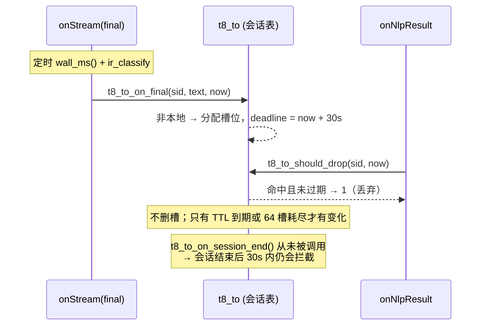

# T8-12 第二阶段：NLU 接管关键路径补充审计

- 基线提交：**`599a9e61c48354c1db927cd242950044d0536cd1`**（`main`）
- 审计时间：2026-11-22 21:11–22:05
- 对象：`/system/app/smartapp/lib/arm/libsmartbox.so`（sha256 `f6e3c354…df80940`）+ `libagutils.so`
- **本阶段只读**：未改任何源码、未启用 takeover、未执行 Injector、未连接设备、未重启 `:core`

证据分级：**【源码】** / **【反汇编】** / **【测试】** / **【未证实】**（含义同第一阶段）。

---

## 〇、本阶段对第一阶段的四处修正

| # | 第一阶段说法 | 本阶段结论 | 依据 |
|---|---|---|---|
| C1 | "`what=11` → `onHandler` → `SessionDispatch::onNlpResultInner`" | **不成立**。`what=11` 使 `what-1=10 > 7`，走 `bhi` 默认分支 `0x11c5c0`，该分支只打一条 `AgutilLog` 后返回，**不调任何 SessionDispatch 方法** | 【反汇编】§2.3 |
| C2 | "`exitTalk` 调用 `onNlpResult(sid, 3, NULL)`" | **不成立**。`exitTalk` 调的是 `onNlpResult(sid, type=2, res=新建 NlpResult)`；`(sid,3,NULL)` 那个形式来自 `onHandler` 自己的收尾块 `0x11cbf8` | 【反汇编】§3.2 |
| C3 | "`SessionDispatch+52` 是会话状态" | 写入点 `0x11c2c0: strb r0,[r4,#52]` 位于 `SessionProxy::onHandler` 内，`r4 = this` 是 **SessionProxy**，所以该字段是 **SessionProxy+52**，不是 SessionDispatch+52 | 【反汇编】§5.3 |
| C4 | "`what=11` 的打包"（隐含 onHandler 是唯一接收者） | `Message` 自带分发目标 `[+16]`（`HandlerCallback*`），`Handler::onHandler` 优先用它；本机三个 Proxy 全部传 NULL，因此**接收者由 `handler[+4]` 决定**——"谁最终调用 `SessionProxy::onHandler`"仍需运行期确认 | 【反汇编】§2.4 |

**对实现的影响**：C1+C4 意味着"云侧 inner 路径是否会被当前补丁点覆盖"这个问题**比第一阶段更不确定**，必须靠 §7 的运行期观测钉死，不能靠静态推断定案。

---

## 一、Git 基线

| 项 | 结果 |
|---|---|
| 分支 / HEAD | `main` / `599a9e61c48354c1db927cd242950044d0536cd1` |
| 与任务书指定提交 | **一致**；未切分支、未改动任何文件 |
| 已跟踪文件 | 干净（`git status --short -uno` 无输出） |

---

## 二、T8-12-2.1 Message 分发关系（完整确认）

### 2.1 `Message` 的真实布局与宿主库

**【反汇编】** `Message::obtain` 在 `libsmartbox.so` 中是 **UND（导入）**，实际定义在 `libagutils.so` @`0x2b528`（500 B）。`libsmartbox.so` 的 `DT_NEEDED` 含 `libagutils.so`；`libagutils_hack.so` 不导出该符号 → **运行时绑定到 `libagutils.so`**。
（另一份 `libAGUtilsExt.so` @`0x17fd0` 也导出同名符号，但不在 `libsmartbox.so` 的 NEEDED 链上，本轮判定为非绑定实现。）

`Message::obtain` 的实参与落位 **【反汇编】**（`evidence/t8-12-p2/msgutils_obtain_2b528.asm.txt`）：

```
2b534: mov r8,  r0     ; arg0
2b548: mov r10, r1     ; arg1
2b540: mov r9,  r2     ; arg2
2b53c: mov r7,  r3     ; arg3
...
2b6b8: stm r4, {r8, r10}   ; [obj+0]  = arg0
2b6bc: str r9,  [r4, #8]   ; [obj+8]  = arg2
2b6c0: str r7,  [r4, #12]  ; [obj+12] = arg3
2b6c4: str r0,  [r4, #16]  ; [obj+16] = arg4 (HandlerCallback*)
2b6cc: ldr r1, [r11,#8]
2b6d0: str r1,  [r4, #20]  ; [obj+20] = arg5 (fn)
```

| 偏移 | 含义 | 依据 |
|---|---|---|
| `+0` | arg0 —— **`what`** | 上述 store |
| `+4` | arg1 —— 本机三处都放 **sessionId** | 上述 store + 三处调用点 |
| `+8` | arg2 —— 由调用方决定（`type` / 标志 / 0） | 同上 |
| `+12` | arg3 —— `NlpResult*` 或字段指针 | 同上 |
| `+16` | arg4 —— `HandlerCallback*`（**分发目标**） | `Handler::onHandler` 读它 |
| `+20` | arg5 —— free 函数指针（回收用） | 上述 store |
| `+36` | 投递该消息的 `Handler*` | `postMessage` 写入 |

> **注意**：`[+16]` 是**回调对象**，`[+20]` 是**释放函数**。第一阶段曾把 `[+16]` 当成函数指针，本阶段纠正。

### 2.2 投递与分发机制

**【反汇编】** `Handler::postMessage(Message*)` @`libagutils 0x2d2f4`（`msgutils_postMessage_2d2f4.asm.txt`）：

```
2d2fc: r4 = msg ; r1 = this(Handler)
2d310: str r1, [r4, #36]        ; msg->handler = this
2d314: r0 = [r1, #8]            ; handler->[8] = 投递用的队列/线程对象
2d318: if (r0 == 0) → 直接回收并返回
2d320: r1 = msg, r2 = 0, r3 = 0
2d32c: bl [plt+0x968]           ; handler->[8]->post(msg, 0, 0)
```

**【反汇编】** `Handler::onHandler(Message*)` @`libagutils 0x2d6a0`（`msgutils_onHandler_2d6a0.asm.txt`）：

```
2d6a4: r0 = msg->[16]           ; HandlerCallback*
2d6a8: if (r0 == 0) r0 = [this + 4]   ; 退回到 handler 自带的回调对象
2d6b0: if (r0 == 0) return
2d6b8: r2 = [r0]                ; vtable
2d6bc: r2 = [r2]                ; slot 0
2d6c0: bx r2                    ; call cb->slot0(msg)   (r1 仍是 msg)
```

关键：**三处 Proxy 打包时的 `[+16]` 都是 NULL**，实际承载的是 `[+20]`：

| 打包点 | `[+16]` (cb) | `[+20]` (fn) | GOT 符号 |
|---|---|---|---|
| `SessionProxy::onStream` @`0x11d7b0` | `str r9,[sp,#4]`，`r9=0` → **NULL** | `0x11d7b0 str r0,[sp]` → GOT `0x1ef4ac` | `HandlerMessageFreeFun(Message*)` |
| `SessionProxy::onNlpResult` @`0x11d9d4` | `0x11d9c8 str r0,[sp,#4]`，`r0=0` → **NULL** | GOT `0x1ef504` | `HandlerMessageFreeObjFun(Message*)` |
| `SessionProxy::onNlpResultInner` @`0x11da20` | `0x11da18 mov r2,#0` + `[sp+4]=0` → **NULL** | GOT `0x1ef504` | `HandlerMessageFreeObjFun(Message*)` |

`[+20]` 的两个符号都是**消息回收钩子**（`FreeFun` / `FreeObjFun`），不是业务回调。所以这三类消息的**实际接收者**由 `handler[+4]` 决定，而不是由消息自带。

**【未证实】** `handler[+4]` 指向哪个对象、其 `slot0` 是否等于 `SessionProxy::onHandler`。
间接证据：`SessionProxy` 的 vtable @`0x1ecfe4` 的第 3 个槽（`0x1ecfec`）由 `R_ARM_ABS32` 重定位填 `0x11c238`（即 `SessionProxy::onHandler`）——说明 `SessionProxy` **确实以虚函数方式暴露 `onHandler`**，是"消息处理器"的实现者之一。但是否就是本路径的接收者未证实。

### 2.3 `onHandler` 的跳表：表项、分支入口、可达调用

**【反汇编】** 反汇编 + 跳表字节读取，见 `evidence/t8-12-p2/jump_table_branches.txt`。

调度结构（`SessionProxy::onHandler` @`0x11c238`，2924 B）：

```
11c244: ldrd r8, r9, [r1]      ; r8 = msg->what, r9 = msg->arg1 (sessionId)
11c250: cmp r8, #9
11c254: bhi 0x11c37c           ; ① what > 9  → 0x11c37c
11c258: r1 = (r8 == 2) ? 0 : 1 ; clz + lsr #5
11c25c: r0 = [r4, #4]
11c26c: bl  [plt+0x5fcc](r0, r1, sid)
11c274: beq 0x11c3c8           ; ② 该查询返回 0 → 0x11c3c8
11c278: r0 = r8 - 1
11c27c: cmp r0, #7
11c280: bhi 0x11c5c0           ; ③ what > 8 → 0x11c5c0（默认分支）
11c284: r1 = 0x11c290
11c288: r0 = table[r0]
11c28c: add pc, r1, r0         ; ④ 跳表分发
```

跳表（`0x11c290`，8 项，`what = idx + 1`）：

| what | 表项值 | 分支入口 | 该分支可达的调用（BFS 上近似） |
|---|---|---|---|
| 1 | `0x00000020` | `0x11c2b0` | `getFilterText`(0x11c2f4)、**`SessionDispatch::onStream`**(0x11c328)、`Message::obtain`(0x11c348)、`getTimeout`(0x11c358)、`postMessage`(0x11c374)；经 `0x11c2b8 bne→0x11c9f4` 还可到 `getSessionStatus`(0x11c9f8)、`removeMessage`(0x11cbd4)、`setSessionStatus`(0x11cbe4)、**`SessionDispatch::onNlpResult`(0x11cbf8)**、`removeMessage`(0x11cc04) |
| 2 | `0x00000364` | `0x11c5f4` | `setSessionStatus`(0x11c634)、**`onStartTalk`**(0x11c640)、`string::assign`×2、`getWakeupType`(0x11c678)、`Message::obtain`(0x11c6a0)、`getTimeout`(0x11c6b0)、`postMessage`(0x11c6c8)、`IMmiCore`(0x11c6cc)、`getInputType`(0x11c6e4)、`getInputDevice`(0x11c6f4)、`InputDevice::getFeedBackListener`(0x11c7b8) |
| 3 | `0x00000530` | `0x11c7c0` | `setSessionStatus`(0x11c800)、**`onStopTalk`**(0x11c80c)、`Message::obtain`(0x11c82c)、`getTimeout`(0x11c83c)、`postMessage`(0x11c854) |
| 4 | `0x000005d0` | `0x11c860` | 分支体只有 5 条指令 + 尾跳：`ldr r0,[r4,#8]`(dispatch) / `mov r1,r9`(sid) / `ldr r2,[r5,#8]`(msg->arg2) / `pop{…,lr}` / `0x11c874 b <plt[2054]>` → **`SessionDispatch::onVolume(int,int)`**（尾调用，BFS 不跟进尾跳，按指令逐条读出） |
| 5 | `0x000005e8` | `0x11c878` | `getFilterText`(0x11cb1c)、**`SessionDispatch::onStream`**(0x11cb50)、`Message::obtain`(0x11cb70)、`getTimeout`(0x11cb80)、`postMessage`(0x11cb9c)、`setSessionStatus`(0x11caf8)、`string::assign`(0x11cc2c) |
| 6 | `0x0000069c` | `0x11c92c` | 区域内 8 条指令，无可达外部调用 |
| 7 | `0x000006b8` | `0x11c948` | **`SessionProxy::onNlpResultInner(int,int,NlpResult*)`**(0x11c95c)、`SessionManager::onNlpResultEnd`(0x11c970) |
| 8 | `0x00000724` | `0x11c9b4` | `SessionManager::setSessionTtsStatus`(0x11c9c0) |

三个非跳表入口（`bhi`/`beq` 目标）：

| 入口 | 触发条件 | 可达调用 |
|---|---|---|
| `0x11c37c` | `what > 9` | 8 条指令，**无可达调用** |
| `0x11c3c8` | `plt[?]`查询返回 0 | `AgutilLog`(0x11c404) 后返回 |
| `0x11c5c0` | `what-1 > 7`（即 `what > 8`） | 17 条指令，**仅 `AgutilLog`**(0x11c404) |

**BFS 是上近似**：条件分支的两条边都被跟进，因此表中"可达"只表示"可能执行"，不表示"必然执行"。

### 2.4 三条索引自洽性检验（证明跳表映射没搞错）

若映射有误，下面的对应关系不可能同时对：

| 打包方 | 打包 `what` | 该 `what` 的分支调用了谁 | 是否自洽 |
|---|---|---|---|
| `SessionProxy::onStream` | 5（`0x11d7b4`） | `SessionDispatch::onStream`（文本流） | ✓ |
| `SessionProxy::onNlpResult` | 7（`0x11d9d8`） | `SessionProxy::onNlpResultInner(int,int,res)` + `onNlpResultEnd` | ✓ |
| `SessionProxy::onNlpResultInner(int,res)` | 11（`0x11da24`） | **默认分支（仅日志）** | ✗ 见下 |

前两条各自"打包什么 → 处理什么"完全对应，说明跳表基址/索引/`what = idx+1` 三项都正确。第 3 条因此不是映射错误，而是**事实**：`what=11` 在本 build 里没有对应分支。

### 2.5 三个未覆盖入口的调用块：不是跳表可达代码

`onHandler` 符号范围内另有 4 个**无符号小块**，只有它们调用另外三个 NLP 入口：

| 块 | 首地址 | 内容 | 入口来源 |
|---|---|---|---|
| A | `0x11c410` | `SessionDispatch::onNlpResultInner(this->[8], sid, msg->[12])`（0x11c41c）→ `b 0x11c434`（`msg->[12]=0`，返回） | **未证实** |
| B | `0x11c424` | `SessionDispatch::onPushNlpResult(this->[8], sid, msg->[12])`（0x11c430）→ 落入 0x11c434 | **未证实** |
| C | `0x11c444` | 日志 → 尾跳 `SessionDispatch::onSpecialNlpResult`（`plt[2049]`），`r2 = msg->[12]` | **未证实** |
| D | `0x11c4e0` / `0x11c578` | `shared_ptr` 处理 + 日志 + 尾跳 | **未证实** |

证据：
- 全库 `.rel.dyn` 中没有任何 `R_ARM_ABS32/RELATIVE` 的 addend 指向这四个块的入口（只有 `0x1ecfec → 0x11c238` 指向 `onHandler` 本身）；
- 跳表 8 项与三个 `bhi`/`beq` 目标都到不了它们（BFS 已验证）；
- 因此它们**只能**由"未在本文件静态可见的机制"进入 —— 最可能是 `handler[+4]` 那个回调对象的 vtable（其内容在运行时构造），其次是别的模块的本地调用。

**【未证实】这是本阶段最大的未知**，直接决定 §2 的核心问题。验证方式见 §7（U1）。

### 2.6 T8-12-2.1 结论

| 问题 | 结论 | 等级 |
|---|---|---|
| 普通 ASR 文本走哪个入口 | `SessionProxy::onStream` 打包 `what=5` → 分支 `0x11c878` → `SessionDispatch::onStream`（另有 `what=1` 分支也调 `onStream`） | 【反汇编】 |
| 带 `NlpResult*` 的 NLU 结果走哪个入口 | `SessionProxy::onNlpResult` 打包 `what=7` → 分支 `0x11c948` → `SessionProxy::onNlpResultInner(int,int,res)` → **`SessionDispatch::onNlpResult`**（`0x11d674` 尾调） | 【反汇编】 |
| 云侧 inner 结果（`SessionProxy::onNlpResultInner(int,res)`） | 打包 `what=11`，落到**默认分支，仅日志**；其真正接收者是块 A（`0x11c410`），而块 A 的调用者未证实 | 【反汇编】+ **【未证实】** |
| 三个未覆盖入口是否可被 `onHandler` 触达 | **当前静态证据下不可达**（无跳表项、无静态指针、无 BFS 路径） | 【反汇编】 |

> 结论：**`SessionDispatch::onNlpResult` 确实是"带 NlpResult\* 的 NLU 结果"的必经点（what=7 路径），但 `onNlpResultInner` / `onPushNlpResult` / `onSpecialNlpResult` 的调用方完全未知**。第一阶段"三个兄弟入口都会执行技能，故补丁不够"的判断方向上仍成立；但"云侧常规路径必然走 inner 且被漏掉"这一具体论断，本阶段**既不能证实也不能否证**。

---

## 三、T8-12-2.2 NULL 结果与会话收尾（重点）

### 3.1 谁在用 NULL / 合成结果调用 `onNlpResult`

**【反汇编】** 全库 3 个调用点（完备，见第一阶段 §3.1）：

| 调用点 | 调用者 | `r2` (type) | `r3` (res) | 现场 |
|---|---|---|---|---|
| `0x111134` | `SessionManager::exitTalk(int,uchar)` | **2** | **新建对象**（非 NULL） | 见 3.2 |
| `0x11cbf8` | `SessionProxy::onHandler` | **3** | **NULL** | 见 3.3 |
| `0x11d674` | `SessionProxy::onNlpResultInner(int,int,res)` | `r6`=type | `r5`=res | 真结果 |

### 3.2 `SessionManager::exitTalk` —— type=2 + 合成结果

**【反汇编】** `evidence/t8-12-p2/exitTalk_1110e4.asm.txt`：

```
1110f0: r4 = [this+64]           ; 当前会话 id
1110f4: r8 = r2 (flag)           ; 第二参数
1110f8: r6 = r1 (sid)
1110fc: if (flag == 0) → 0x111148   ; flag==0 时**根本不调** onNlpResult
111108: r0 = 152 ; bl operator new  ; 分配 152 字节
111110: r7 = 新对象
111118: r0 = 1 ; r1 = 2 ; stmib r7, {r0, r1}   ; obj[4]=1, obj[8]=2
111124: r1 = r6 (sid)
111128: r2 = 2                    ; type = 2
11112c: r0 = [r5+16]              ; SessionManager+16 = SessionDispatch*
111130: r3 = r7                   ; res = 合成对象（**非 NULL**）
111134: bl  SessionDispatch::onNlpResult(this=dispatch, sid, 2, res)
111138: r0=[r7]; r1=[r0+4]; blx r1   ; 虚析构临时对象
```

要点：
1. `flag == 1` 时才调用；`flag == 0` 直接跳过 → **`exitTalk(sid, 0)` 不会触发 `onNlpResult`**。
2. type 恒为 **2**，`res` 是**堆上新建的 152 字节 `NlpResult`**，且预先写了两个字段（`[+4]=1`、`[+8]=2`）。
3. 这是"**合成**结果"，不是真实 NLU 输出 —— 它的作用是让 CDM 走一遍"本轮结束"的处理。

### 3.3 `SessionProxy::onHandler` 收尾块 —— type=3 + NULL

**【反汇编】** `evidence/t8-12-p2/handler_11c408_11c5c8.asm.txt` 与第一阶段 `handler_dispatch_11cbb0.asm.txt`：

```
11cbcc: r0 = [r4+12] ; r1 = 1 ; bl Handler::removeMessage(int)      ; 撤销超时消息
11cbd8: r0 = [r4+4]  ; r1 = sid ; r2 = 6 ; bl SessionManager::setSessionStatus(sid, 6)
11cbe8: r0 = [r4+8]  ; r1 = sid ; r2 = 3 ; r3 = 0
11cbf8: bl SessionDispatch::onNlpResult(this->[8], sid, 3, NULL)     ; type=3, res=NULL
11cbfc: r0 = [r4+12] ; r1 = 1 ; bl Handler::removeMessage(int)
11cc20: bl SessionManager::onNlpResultEnd(...)                      ; 见 what=7 分支
```

即：**收工前先把会话状态置 6，再带 `NULL` 结果通知 CDM，再清理消息，最后 `onNlpResultEnd`。**

这条路径由 `what=1` 分支（`0x11c2b8 bne → 0x11c9f4`）可达，也就是**消息 `what=1` 且 `arg2 != 1`** 时触发。

### 3.4 `playAudios` 对 NULL 的自我保护（关键）

**【反汇编】** `playAudios` @`0x117d40`：

```
117d4c: r4 = r3        ; arg3 = NlpResult*
117d74: cmp r4, #0
117d78: beq 0x117e6c   ; **res == NULL → 跳过整个媒体/指令执行段**
117d7c: ldr r0, [r4, #144]   ; 只有 res 非空才解引用
```

→ `type=3, res=NULL` 这条收尾调用**不会**执行任何原厂技能（安全）。真正会执行技能的是 `res != NULL` 的调用（`what=7` 路径与 `exitTalk` 的合成对象）。

### 3.5 当前 `tg_nlp_cb` 是否区分"真结果"与"收尾"

**【源码】** `libtg_hook.c:820-842`：

```c
static int tg_nlp_cb(void *self, int sid, int type, void *res)
{
    (void)self; (void)type; (void)res;      /* ← type / res 全部丢弃 */
    mode = nlu_mode_now();
    if (mode == NLS_PASS) return 0;
    ...
    if (sid > 0) snprintf(key, sizeof(key), "%d", sid); else key[0] = '\0';
    drop = t8_to_should_drop(&g_to, key, wall_ms());
    ...
    return drop ? 1 : 0;
}
```

**结论：完全不区分。** 只按 `sid` 查表，`type` 与 `res` 一律忽略。

### 3.6 由此产生的会话生命周期破坏（本阶段最重要的风险）

接管开启且该 `sid` 已登记时，`t8_to_should_drop()` 对**同一 sid 的一切调用**都返回 1（`nlu_takeover.c:268-271`：命中槽位即 `s->drops++; st->dropped++; rc = 1`），于是：

| 被丢弃的调用 | 原本会做什么 | 被丢弃后的后果 |
|---|---|---|
| `onNlpResult(sid, 7/真 type, 真 res)` | 执行技能 / 播报 / `setSessionTtsStatus` / CDM `onSpeakCommand` | 这是我们**想**丢的 |
| `onNlpResult(sid, 2, 合成对象)`（`exitTalk`） | 让 CDM 走一轮"本轮结束" | **CDM 不知道本轮结束**；`setSessionTtsStatus`、`processCommand` 被跳过 |
| `onNlpResult(sid, 3, NULL)`（收尾块） | 带 NULL 通知 CDM 收尾 | 同上（虽然它本身不执行技能） |

而**收尾块里的其他动作仍会执行**（`0x11cbd4 removeMessage`、`0x11cbe4 setSessionStatus(sid,6)`、`0x11cc20 onNlpResultEnd`）——它们在 `onNlpResult` 调用点的**前后**，不受补丁影响。

即：会话状态机会被推进到 6，但 CDM 侧收不到"结果"，`setSessionTtsStatus` 也不会被调用 → **状态不一致**（管理器认为会话已结束，CDM 认为结果还没到）。

**【测试】** 佐证：T8-11 的 20 条真实语音里，`native_route.public.json` / Worker 的 `session.state` 都依靠原厂正常收尾；本轮无法直接验证丢弃后的行为（禁止开 takeover）。

### 3.7 槽位的消费、清理与重复调用行为

**【源码】** `nlu_takeover.c`：

| 行为 | 实现 | 后果 |
|---|---|---|
| 命中槽位 | `s->drops++; st->dropped++; rc = 1`（`:268-271`） | **不删槽、不清槽** —— 同一 sid 的后续调用继续被丢 |
| TTL 过期 | `deadline_ms <= now` → `t8_clear(s); st->expired++; s = NULL;` 然后落到"未登记"分支 | 30 s 后自动放行 |
| 显式释放 | `t8_to_on_session_end()`（`:288-298`） | **从未被调用**（见下） |
| 清理过期 | `t8_to_purge()`（`:300-309`） | **从未被调用**（内部 `t8_purge_locked` 由 `on_final/should_drop/snapshot` 间接执行） |

**【源码】** `libtg_hook.c` 里 `t8_to_*` 的全部调用点（逐条核对）：

```
746  t8_to_init                  756/1139/1203/1274/1291/1299  t8_to_enabled_set
810  t8_to_on_final              839  t8_to_should_drop
1282/1299 t8_to_enabled          1486 t8_to_snapshot_take
```

→ **`t8_to_on_session_end()` 与 `t8_to_purge()` 没有任何调用点**。

**含义**：登记一旦建立，只能等 30 s TTL 自然过期；会话结束后无法提前解除。结合 3.6，**"会话已结束但仍在 30 s 拦截窗口内"的调用（含收尾调用）会被一并丢掉**。这是一条必须先解决的设计缺口，而不是实现细节。

### 3.8 type / res 是否应参与拦截判定

**结论：应当参与。** 依据（全部来自上面的反汇编）：

| 依据 | 说明 |
|---|---|
| `res == NULL` ⇒ 只有收尾语义 | `playAudios` 在 `res==NULL` 时跳过全部执行段（§3.4）；`type=3` 只出现在这条路径 |
| `type == 2` ⇒ 合成结果 | `exitTalk` 造一个只含 `[+4]=1,[+8]=2` 的空对象（§3.2），不是真实 NLU |
| `type == 6` ⇒ 特殊替换 | `onNlpResult` 内部 `cmp [sp,#40], #6` 时另造 `NlpResult`（第一阶段 §3.2 已记录，`[sp,#40]` 是否就是 `type` **【未证实】**） |

**保守判据建议（供 ChatGPT 决策，本阶段不实现）**：只拦截 `res != NULL` 的调用；`res == NULL` 一律放行，让原厂收尾。`exitTalk` 的 `type=2` 是否放行需要进一步证据（它带非空 res，会真正执行技能）。

---

## 四、T8-12-2.3 `playAudios` 参数语义

### 4.1 完整调用者

**【反汇编】** `playAudios` @`0x117d40`（748 B）只有 3 个调用者：

| 调用点 | 调用者 | `r1` | `r2` | `r3` | 栈 |
|---|---|---|---|---|---|
| `0x118a2c` | `onPushNlpResult` | 待读 | — | — | — |
| `0x11899c` | `onNlpResultInner` | `#131072` (`0x20000`) | `r4`=sid | `r5`=res | `[sp]=&sp+12`，`[sp+4]=0` |
| `0x119200` | `onNlpResult` | `#65536` (`0x10000`) | `r6`=sid | `r10`=res | `[sp]=&sp+40`，`[sp+4]=&sp+39` |

### 4.2 `r1` 是什么：位掩码，不是枚举

**【反汇编】** `playAudios` 体内 `r1` 只被保存在 `r8`（`0x117d54: mov r8, r1`），全程**只有一处使用**：

```
117fb4: r0 = [r10, #16]        ; 某个数组/表指针
117fb8: r1 = 0
117fbc: r2 = [r0, r1, lsl #2]  ; 取第 0 个元素
117fc0: tst r2, r8             ; ← r8 (=arg1) 与 r2 做按位与
117fc4: bne 0x117fe8           ; 命中 → 走 0x117fe8
117fc8: r1 = r1 + 1
117fcc: cmp r1, r6
117fd0: blo 0x117fbc           ; 循环遍历
```

→ **`arg1` 是"掩码"，用来和某个元素表里的值做按位测试**（`tst`），不是"模式编号"。

| 调用方 | 掩码 | 与第一个可执行调用 |
|---|---|---|
| `onNlpResult` | `0x10000` | 走到 `AudioManager::processMediaCommand`（`0x117db8`） |
| `onNlpResultInner` / `onPushNlpResult` | `0x20000` | 同上（`processMediaCommand` 是唯一执行入口） |

**【未证实】** 掩码的位含义（哪一位代表"允许执行媒体指令"）。要证实必须知道 `[r10,#16]` 指向的元素表内容（运行期数据），静态无法确定。

### 4.3 是否可统一拦截 / 是否存在其他技能执行路径

| 问题 | 结论 | 依据 |
|---|---|---|
| 两条路径能否统一拦截 | **能**：`playAudios` 是唯一汇聚点，且 `res==NULL` 时自动跳过 | 【反汇编】§3.4 + 3 个调用者 |
| 是否有别的技能执行路径 | **`AudioManager::processMediaCommand` / `preProcessCommand` 的唯一调用者就是 `playAudios`**（全库 xref，第一阶段 `xref_skill_entrypoints.txt` 第 8-9 行） | 【反汇编】 |
| 是否有更安全/覆盖更完整的拦截位置 | 事实：`playAudios` 覆盖 3 个 NLP 入口；`onNlpResult` 覆盖 1 个。**本阶段不建议改动补丁位置**（任务书 §2.3 明确）。若将来评估，`playAudios` 入口 8 字节序言需另行核对 | 【反汇编】 |

`playAudios` 序言（供将来核对，**本轮不动**）：`push {r4-r11,lr}` / `add r11,sp,#28` —— 与 `onStream`/`onNlpResult` **相同的 8 字节**（`0xE92D4FF0 / 0xE28DB01C`）。

---

## 五、T8-12-2.4 原厂"本地技能 vs AI"的区分机制

### 5.1 `needNlp`

**【反汇编】** `SessionManager::onStream`（`0x11353c`，6 参数）：

```
113540: add r11, sp, #28           ; 栈参数基址
11354c: r0 = [r0, #64]             ; 当前会话 id
113554: cmp r0, r1
113558: bne 0x113714               ; **sid 与会话不符 → 直接跳走**
11355c: r8  = r2                   ; text
113568: r12 = [r11, #12]           ; **needNlp**（第 3 个栈参数）
113574: cmp r12, #0
113578: bne 0x1135a4               ; needNlp != 0 → 原样传文本
11357c: r1  = [r6, #132]           ; SessionManager+132
113590: cmp r1, #1
113594: r1  = r9                   ; sid
113598: str r4, [sp]               ; noDisplay
1135a0: movne r2, r8               ; needNlp==0 时 r2 = text
1135a4: bl SessionProxy::onStream(int, const char*, uchar, uchar)
```

结论：
- **`needNlp` 在 `0x113568` 被读取**，并决定文本是"原样"还是"被替换成某个常量串"；
- `needNlp != 0` 与 `== 0` 走**不同**的文本处理；
- 但 `SessionProxy::onStream` 只接收 2 个 char（`isFinished` + `noDisplay`），**`needNlp` 不再向下传递** → 到 CDM 层就没有这个信息了；
- 我们的 Hook 只读 `r3`（`isFinished`），**没有采集 `[sp+4]` 的 `needNlp`**。

**【未证实】** `needNlp != 0` 是否严格等价于"本轮会进 NLU/会产生 AI 会话"。它是"是否需要 NLU"的正向指示，但与"AI 会话"是否一一对应未验证。

### 5.2 `isOffline`

**【反汇编】** 同函数 `0x1135b0: r5 = [r11, #8]`（第 1 个栈参数 = `isOffline`），此后只在日志段（`0x1116xx` 附近的 `AgutilLog` 参数装配）被使用。

→ `isOffline` 在本函数里**只用于日志**，不影响控制流；且不向下转发。

**【测试】** 既有记录（`asr_independent/T7-11_VOICE_OBSERVATION.md`）观测到云端会话 `isOffline = 0`（29/29）。

### 5.3 `SessionDispatch+52` → 实为 `SessionProxy+52`

**【反汇编】** 写入点：`SessionProxy::onHandler` 内

```
11c2b4: cmp r0, #1
11c2b8: bne 0x11c9f4
11c2bc: r0 = 2
11c2c0: strb r0, [r4, #52]      ; r4 = this = **SessionProxy***，写入常量 2
```

即：`what=1` 且 `msg->arg2 == 1` 时，把 **SessionProxy+52** 置为 2。语义 **【未证实】**（候选：SessionProxy 的临时状态/模式字节）。

> 第一阶段把它记作 `SessionDispatch+52`，本阶段按所在函数修正。

### 5.4 `SessionManager+132`

**【反汇编】** 读取点：`SessionManager::onStream` 内

```
11357c: r1 = [r6, #132]     ; r6 = this = SessionManager*
113590: cmp r1, #1
```

即：`needNlp == 0` 时用它决定文本替换分支。语义 **【未证实】**（候选：本地/云端模式位、或"是否允许文本替换"的开关）。

**为什么无法给出更多**：`+52`/`+132` 这类小偏移在整库里出现 356 次（`evidence/t8-12-p2/offset_52_132_sites.txt`），全部是不同类的同偏移字段。没有类型传播（反编译器）就无法把寄存器与类型对齐 → **该文件只作为"为何不能用偏移扫描下结论"的证据保留，不作为语义证据**。

### 5.5 `ContinuousDialogManager::onSpeakCommand` 与 `onRouterDetailInfo`

**【反汇编】** 两者都是 `onNlpResult` 直线路径上的一环（第一阶段 §3.2）：

| 函数 | 地址/大小 | 在链中的位置 | 是否本地/AI 判别点 |
|---|---|---|---|
| `SessionDispatch::onRouterDetailInfo(int,int,NlpResult*)` | `0x118830` / 316 B | `onNlpResult` 的**第一步**（`0x1191d8`）；`playAudios` 之后又调一次 | **否**：它是"把路由明细写进结果对象"，两侧（本地/AI）都要走 |
| `ContinuousDialogManager::onSpeakCommand(int,json_object*,uchar)` | `0x1566f0` / 528 B | `playAudios` 之后（`0x119358`），由 `MmiCtx::getContinuousDialogManager()` 取得 | **否**：它处理"要不要继续对话"，不区分本地/AI |

**【未证实】** 两者的内部分支是否含本地/AI 判别。本阶段未反汇编其函数体（`onSpeakCommand` 在 `libsmartbox.so` 内，可后续补；本轮受上下文预算限制未展开）。

### 5.6 能否用原厂机制替代 `ir_classify`

| 候选判据 | 静态可获得性 | 能否替代 `ir_classify` |
|---|---|---|
| `needNlp`（onStream 第 3 栈参数） | Hook 现场即可读（`[sp+4]`），但语义未证实 | **有潜力**，需 U3 验证 |
| `isOffline`（第 1 栈参数） | 同上；本函数内只用于日志 | 不能（不区分本地/AI） |
| `type`（`onNlpResult` 的 `r2`） | Hook 现场可读；已知 2/3/6 有特殊含义 | **可作为"放行收尾"的判据**，不能替代意图分类 |
| `res != NULL` | Hook 现场可读 | **可作为"这是真结果"的判据**（最有价值） |
| `SessionProxy+52` / `SessionManager+132` | 语义未知 | 不能 |

→ **结论**：本轮**没有找到**一个可静态证实、能替代 `ir_classify` 的"本地 vs AI"真值来源。最接近的是 `needNlp`，但它只回答"要不要 NLU"，不回答"是不是本地技能"。二者不是同一维度，不能互换。

---

## 六、T8-12-2.5 sessionId 与登记机制（补充）

### 6.1 sid 传递链（本阶段新增证据）

| 环节 | 事实 | 依据 |
|---|---|---|
| `SessionManager::onStream` **校验 sid** | `0x11354c ldr r0,[this+64]; 0x113554 cmp r0,r1; 0x113558 bne 0x113714` → **会话 id 不匹配时整个回调走另一条路** | 【反汇编】 |
| `SessionManager+64` 是"当前会话 id" | 同一处比较 + `exitTalk` 里 `0x1110f0 ldr r4,[r0,#64]` 作为"当前会话" | 【反汇编】 |
| `onStream → Message` | `Message::obtain(what=5, arg1=sid, arg2=flags, obj=text, fn=FreeFun, cb=NULL)` | 【反汇编】§2.2 |
| `onHandler` 取 sid | `0x11c244 ldrd r8,r9,[msg]` → `r9 = msg->arg1 = sid`，后续 `mov r1,r9` 传给所有下游 | 【反汇编】 |
| NLU 侧 sid | `SessionManager::onNlpResult` 的 `r1` → `SessionProxy::onNlpResult(what=7)` 的 `arg1`；`RouterManager::onResponse` 的 `r1` → `onNlpResultInner` → `what=11` 的 `arg1` | 【反汇编】 |

**【未证实】** 两侧 sid 数值相等（U2）。**新增的风险细节**：`onStream` 内部已有 sid 校验（`cmp [this+64], sid`），说明"sid 与会话槽一致"是原厂自己的不变量；但 NLU 侧是否做同样校验，本阶段未查到（`onNlpResult` 未见对 `[this+64]` 的比较）。

### 6.2 会话结束与槽位清理时序

**【源码】** 现状（结合 §3.7）：



### 6.3 同一 sid 多次 final

**【源码】** `nlu_takeover.c:212-221`：命中已有槽位 → `reentrant_marks++`、刷新 `deadline_ms`、更新 `why/intent/rule`、`marked++`，**不新建槽位**（去重）。

**【反汇编】** 但 `SessionManager::onStream` 只在 `sid == [this+64]` 时继续（§6.1），所以"同一 sid 的多次 final"在 onStream 侧是被允许的（同一会话多段 partial/final），Hook 会在每次 `isFinished==1` 时调用 `nlu_note_final` → 触发上面的去重分支。

### 6.4 复用、回绕与异常值

| 情形 | 静态能否证明 | 结论 |
|---|---|---|
| sid **复用**（旧 id 被新会话重用） | 不能 | 需长时采样（U6） |
| sid **回绕** | 不能 | 需长时采样（U6） |
| sid **<= 0** | **能** | 【源码】`libtg_hook.c:808-809 / 837-838` 允许，key 置空 → `t8_to_on_final` 开 5 s fail-closed 窗口（`nlu_takeover.c:182-191`），**该窗口内所有未登记会话的结果都会被丢** |
| sid 与 `[this+64]` 不一致 | **能** | 【反汇编】原厂自己在 `onStream` 里就丢弃这类调用；即 Hook 侧看到 `sid` 时它已经过原厂校验 |

### 6.5 TTL / 容量 / 降级

**【源码】** 与第一阶段结论一致，本阶段补充"实际是否会被触发"的量化：

| 机制 | 参数 | 现状 |
|---|---|---|
| TTL | `T8_TO_TTL_MS = 30000` | 唯一有效的释放途径（`on_session_end` 未接线） |
| 容量 | `T8_TO_SLOTS = 64` | 真机实测并发会话 = 1；**但因为没有提前释放，30 s 内累积的"已结束会话"也占槽**。T8-11 的 20 条语音在 11 分钟内产生，若 takeover 开着且每次都登记，30 s 窗口内最多 2-3 条 → 距 64 仍远。**风险等级：低** |
| 降级窗口 | `T8_TO_DEGRADED_MS = 5000` | 只在 overflow 或 sid 缺失时开启 |

---

## 七、动态验证方案（只统计、不拦截；本阶段不执行）

三个待验证项 U1–U3 必须在真机上观测。以下方案**只写不执行**，等 ChatGPT 批准。

### 7.1 共同前提（保证不改变原厂语音行为）

| 约束 | 做法 |
|---|---|
| 不启用 takeover | 全程 `nls_takeover == 0`；观测代码不调用 `nls_set_takeover` / `t8_to_enabled_set(1)` |
| 不改现有 Hook 逻辑 | 观测点写成**独立的只读探针**（新增导出函数 + 独立 stub 页），与现存的 `tg_onstream_cb` / `tg_nlp_cb` 并存；现有两处不改一行 |
| 探针返回值恒为"零影响" | 观测 stub 一律 `return 0`（放行原厂）；不许出现 `1` |
| 不改补丁位置 | 仍只补 `onStream`(`0x11353c`) 与 `onNlpResult`(`0x118ebc`)；新增观测点若需补 `onNlpResultInner`(`0x11896c`)，**只装"纯日志 + 恒返回 0"的 stub** |
| 不写业务状态 | 探针只 `__atomic_add_fetch` 计数 + 环形缓冲写固定长度记录；不 malloc、不 I/O、不在回调里打日志 |
| 导出不留后门 | 只新增 `--nlu-probe-dump`（读环形缓冲）与 `--nlu-probe-reset`（清缓冲）；不提供任何"改行为"的参数 |

### 7.2 观测位置与记录字段

| 探针 | 位置 | 记录字段（定长） |
|---|---|---|
| P1 | `SessionManager::onStream`（`0x11353c`） | `mono_ms`、`sid`、`isFinished`、`isOffline`、`needNlp`、`noDisplay`、`text_len`、`text_hash32` |
| P2 | `SessionDispatch::onNlpResult`（`0x118ebc`，现有补丁点内） | `mono_ms`、`sid`、`type`、`res_is_null`、`res_ptr` |
| P3 | `SessionDispatch::onNlpResultInner`（`0x11896c`，**新增只读桩**） | `mono_ms`、`sid`、`res_is_null` |
| P4 | `SessionProxy::onHandler` 三个小块（`0x11c410/0x11c424/0x11c444`） | 若 P3 不足以定位来源，再按需加；`mono_ms`、`block_id`、`sid` |

缓冲：每探针 256 条 × 32 B = 8 KB，静态数组。溢出只计数不覆盖（`probe_overflow`）。

### 7.3 日志格式（`--nlu-probe-dump` 输出，一行一条）

```
PROBE=P2 t=51234 sid=1968817 type=0 resnull=0 ptr=0xc2e591bb
PROBE=P1 t=51200 sid=1968817 fin=1 off=0 need=1 nd=0 len=48 hash=0x9a3f21c7
PROBE=P3 t=51240 sid=1968817 resnull=0
```

`t` = 进程内 `CLOCK_MONOTONIC` 毫秒（与 Hook 现有 `mono_ms()` 同源），便于跨探针排序。

### 7.4 测试语音场景（复用 T8-11 已建立的声学方法）

| 场景 | 语音 | 期望观测 |
|---|---|---|
| S1 | 唤醒 + "音量调到四十" | P1(`needNlp` 取值) → 原厂技能执行；P2 **不应出现**（本地指令无 NLU 结果） |
| S2 | 唤醒 + "现在几点" | 同上（本地） |
| S3 | 唤醒 + "什么是机器学习" | P1 → **P2 出现**（type/res 取值）→ TTS 播报；记录 P3 是否也出现 |
| S4 | 唤醒 + "介绍一下唐朝" | 同 S3（长回答） |
| S5 | 播报中打断（唤醒 + "为什么天是蓝的"） | 两个 P2/P3 序列，观察收尾调用（type=2 或 3）在 P2 中的出现位置 |
| S6 | 唤醒后不说话（静默超时） | P1 有 final 但无 P2 → 观察是否走 type=2/3 收尾 |

每个场景至少 3 次有效命中（声学 ASR 有约 1/5–1/4 漏检，见 T8-11）。

### 7.5 成功判据（U1/U2/U3）

| 编号 | 判据 | 通过条件 |
|---|---|---|
| U1 | 普通 AI 轮的 NLU 结果走哪个入口 | S3/S4 的 6 次有效样本中，P2 与 P3 的**出现比例**。若 P2 覆盖 100% → 当前补丁点足够；若 P3 出现且 P2 缺失 → 必须扩展拦截点 |
| U2 | 两侧 sid 是否相等 | S3/S4 中，同一次语音的 P1.sid 与随后 P2.sid 逐对相等（6/6）。任一不等 → 接管判定必须改键 |
| U3 | `needNlp` 能否作为"会进 NLU"的判据 | S1/S2（本地）应 `needNlp` 呈现某一取值、S3/S4（AI）呈另一取值，且与是否产生 P2 一致（各 6 次） |
| 附带 | 收尾调用形态 | S5/S6 中观测到 `type=2/3` 且 `resnull=1` 或合成对象，用于确定 §3.8 的放行判据 |

### 7.6 异常停止条件（任一命中即停，恢复原状）

1. `:core` 崩溃、重启或 pid 变化；
2. 任一探针回调里出现 `text_len > 511` 或 `text == NULL` 且非预期；
3. `probe_overflow` 增长（说明缓冲不足，需重新评估而不是继续）；
4. 观测期间出现**任何** TTS 双播、抢答、会话卡死；
5. `tg_hook_status()` 或 `nlu_status` 出现 `hooked != 1`；
6. `slog` 里出现 `probe` 相关错误；
7. 需要用到 `--nlu-on` 或任何会改变行为的手段（方案不允许）。

停止后动作：`--nlu-probe-reset` → 卸载探针（如果单独加载）→ 保留 `--nlu-status` 与 T8 Supervisor 原状 → 记录并报告，不自行恢复。

---

## 八、未证实清单与剩余风险

### 8.1 未证实（按重要度）

| # | 未证实项 | 为什么重要 | 验证方式 |
|---|---|---|---|
| U1' | 块 A/B/C（`0x11c410/0x11c424/0x11c444`）的调用者是谁 | 决定"云侧 inner 路径是否绕过补丁"这一核心问题 | §7 P3/P4 |
| U2 | `onStream` 与 `onNlpResult` 的 sid 数值是否相等 | 不等则接管静默失效（fail-open） | §7 P1/P2 |
| U3 | `needNlp` 语义能否作为 NLU 判据 | 影响能否取代文本规则 | §7 P1 + 场景 S1–S4 |
| U4 | `playAudios` 掩码位（`0x10000` / `0x20000`）含义 | 决定两条路径能否统一处理 | 需 `[r10,#16]` 元素表的运行期内容 |
| U5 | `SessionProxy+52` / `SessionManager+132` 语义 | 可能是原厂状态真值 | 需类型传播 + 运行期断点 |
| U6 | sid 复用 / 回绕 | 影响槽位匹配 | 跨天长时采样 `events.jsonl` |
| U7 | `onNlpResult` 内 `[sp,#40] == 6` 的字段是不是 `type` | 决定 `type=6` 特殊替换的含义 | 单步观测 |
| U8 | `onSpeakCommand` / `onRouterDetailInfo` 内部是否含本地/AI 判别 | 决定是否有原厂真值可用 | 反汇编两函数体（未展开） |

### 8.2 剩余风险（相对第一阶段有增删）

| # | 风险 | 变化 | 证据 |
|---|---|---|---|
| R1 | 只拦 `onNlpResult` 一个入口 | **维持**（三个兄弟入口确实会执行技能） | 第一阶段表 + §2.5 |
| R2 | 云侧 inner 路径可能绕过补丁 | **升级为"不确定但更可疑"**：`what=11` 无对应分支（C1），接收者未知（U1'） | §2.3 / §2.5 |
| R3 | 两侧 sid 相等未证实（失效方向 fail-open） | 维持 | §6.1 |
| **R13** | **接管会连收尾调用一起丢**，破坏 CDM 会话生命周期 | **本轮新增（高）** | §3.5–3.6 |
| **R14** | **`t8_to_on_session_end()` 从未接线**，槽位只能等 30 s TTL | **本轮新增（中）** | §3.7 |
| **R15** | `exitTalk` 的 `type=2` 带**非空**合成结果，会真正执行技能；若被误判为"可丢"则技能不执行，若放行则可能抢答 | **本轮新增（中）** | §3.2 |
| R4 | 本地/AI 判定依赖 `ir_classify` 文本规则 | 维持（本轮未找到替代真值） | §5.6 |
| R5 | `needNlp`/`isOffline` 未采集 | 维持 | §5.1–5.2 |
| R9 | `sid<=0` 触发 5 s fail-closed 窗口，误丢其他会话 | 维持 | §6.4 |
| R10-R12 | 懒初始化 / `run_t8_01` 断链 / `prot_state=-1` | 维持 | 第一阶段 |

---

## 九、自查（结论与证据一致性）

| 检查 | 结果 |
|---|---|
| 每条"跳表 → 分支"结论是否有表项字节 + 分支入口地址 | 是（§2.3 全表 + `jump_table_branches.txt`） |
| 是否把 BFS 上近似当成"必然执行" | 否，§2.3 明确标注 |
| 是否用函数名推断语义 | 否；`+52`/`+132`/`mask` 语义一律标 **【未证实】** |
| 是否把偏移扫描当证据 | 否；`offset_52_132_sites.txt` 明确标注"仅证明该方法不可用" |
| 是否与第一阶段结论冲突而未说明 | 否；§〇 列出 4 处修正 |
| 是否声称做过未做的事 | 否；未连接设备、未运行 Ghidra 成功反编译（失败已记录）、未开 takeover |
| 反汇编证据是否可复现 | 是；脚本 `analysis/t8_12/extract.ps1`、`xref.ps1` + 本阶段新增的跳表/可达性方法在 §2.3 中给出判据 |

> 方法学留痕：本阶段尝试用本机 Ghidra 12.1.4 反编译，**19 个目标函数全部返回 `no function at 0x…`**（该 `.so` 已 strip `.symtab`，Ghidra 未在 .dynsym 地址建函数）。因此全部结论改用 `llvm-objdump` + `.rel.plt`/`.rel.dyn` 解析 + 跳表字节读取 + CFG 可达性分析得出，未使用伪代码。

---

## 十、证据文件

`my-doc/07_ai_bridge/evidence/t8-12-p2/`（全部文本，79.6 KB）：

| 文件 | 内容 |
|---|---|
| `jump_table_branches.txt` | **跳表 8 项 + 每项分支入口 + 可达 PLT 调用**（含 3 个 `bhi`/`beq` 额外根） |
| `exitTalk_1110e4.asm.txt` | `exitTalk` 全文：type=2 + 合成结果 + `flag==0` 短路 |
| `handler_11c408_11c5c8.asm.txt` | `onHandler` 内 4 个未覆盖小块（A/B/C/D）的完整指令 |
| `playAudios_full.asm.txt` / `playAudios_head.asm.txt` | `playAudios` 全文（748 B）+ 头部（`res==NULL` 短路、`tst r2,r8`） |
| `msgutils_obtain_2b528.asm.txt` | `libagutils.so` 的 `Message::obtain`（字段落位证据） |
| `msgutils_postMessage_2d2f4.asm.txt` | `Handler::postMessage`（`msg[36]=handler`，入队到 `handler[+8]`） |
| `msgutils_onHandler_2d6a0.asm.txt` | `Handler::onHandler`（`msg[16]` 优先、否则 `handler[+4]`） |
| `offset_52_132_sites.txt` | 356 条同偏移命中，**用于证明"偏移扫描不能作为语义证据"** |

工具（可复现）：`my-doc/07_ai_bridge/analysis/t8_12/{extract.ps1, xref.ps1}`（第一阶段）+ 本阶段跳表/CFG 方法见 §2.3 的判据描述。

---

**T8-12 第二阶段：补充审计完成，等待 ChatGPT 审查。**

本阶段未修改任何生产源码、未启用 takeover、未执行 Injector、未连接真机、未进入 T8-13。真机观测方案（§7）等待批准后执行。
