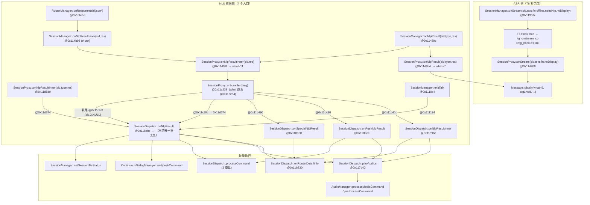
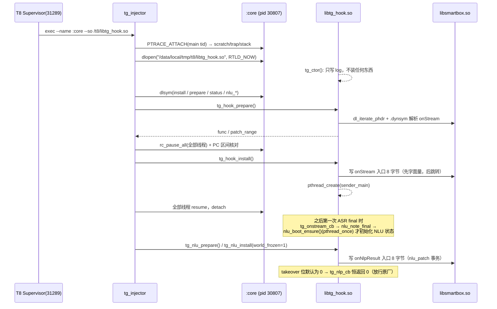

# T8-12 第一阶段：NLU 接管源码审计与证据收集

- 设备/目标：TG-Z02 `AILABS_S1L`，`libsmartbox.so` sha256 `f6e3c3543ff6da5b59bf60b884b6ce4332897c75aa6b89b8dccc0c266df80940`（2 047 772 B，ELF32 ARM，ARMv7，未 strip）
- 审计时间：2026-11-22 20:35–21:05
- **本阶段只读**：未修改任何源码、未新增/删除代码文件、未改 Hook 与接管逻辑、未启用 takeover、未执行 Injector、未接触真机运行状态

**证据分级（全文统一）**

| 标记 | 含义 |
|---|---|
| **【源码】** | 仓库内 C 源码直接证实，给出 `文件:行号` |
| **【反汇编】** | 出厂二进制 `libsmartbox.so` 的反汇编/符号/重定位直接证实，给出地址 |
| **【测试】** | 既有 host 测试或真机记录已观测到 |
| **【未证实】** | 结构上成立但没有直接观测，标注"需要进一步检查"及其方法 |

---

## 〇、三个必须先说的结论

### 结论 1：`SessionDispatch::onNlpResult` 不是唯一的 NLU 结果入口，而是四个之一

**【反汇编】** `SessionDispatch` 有 4 个 NLP 结果入口，其中 3 个会走到"执行原厂技能"：

| 入口 | 地址 / 大小 | 是否调 `playAudios`（→ AudioManager，真正执行技能） | 是否调 `processCommand` |
|---|---|---|---|
| `onNlpResult(int,int,NlpResult*)` | `0x118ebc` / 1952 B | **是**（`0x119200`） | **是**（`0x1194c4`、`0x1194f4`、`0x119550`，两个重载） |
| `onNlpResultInner(int,NlpResult*)` | `0x11896c` / 116 B | **是**（`0x11899c`） | 否（另调 `onRouterDetailInfo` @`0x1189a8`） |
| `onPushNlpResult(int,NlpResult*)` | `0x1189ec` / 1072 B | **是**（`0x118a2c`） | **是**（`0x118cfc`）（另调 `onRouterDetailInfo` @`0x118b70`） |
| `onSpecialNlpResult(int,NlpResult*)` | `0x1189e0` / 12 B | 否（尾跳到 `onRouterDetailInfo`） | 否 |

证据文件：`evidence/t8-12/xref_skill_entrypoints.txt` 全库 23 条 `bl` 交叉引用（无遗漏，见 §3.4 的完备性检查）。

**当前实现只补了这 4 个里的第 1 个。** 这是进入实现阶段前必须解决的第一个问题。

### 结论 2：云侧常规 NLU 路径走的是 `onNlpResultInner`，不是 `onNlpResult`

**【反汇编】** 两条独立的消息路径（`SessionProxy::onHandler` 的 Message `what` 判别，跳表在 `0x11c284`）：

```
路径 A（typed / JNI 侧）
  SessionManager::onNlpResult(int,int,NlpResult*)   @0x11489c
    → SessionProxy::onNlpResult(int,int,NlpResult*) @0x1149d0（Message what=7）
    → SessionProxy::onHandler
    → SessionProxy::onNlpResultInner(int,int,res)   @0x11c95c → @0x11d5d0
    → SessionDispatch::onNlpResult(this,sid,type,res)  @0x11d674   ← 当前补丁点

路径 B（cloud / inner）
  RouterManager::onResponse(int,json_object*)        @0x10ffa4
    → SessionManager::onNlpResultInner(int,res)      @0x114b98（8 字节 thunk）
    → SessionProxy::onNlpResultInner(int,res)        @0x11d9f8（打包 Message what=11）
    → Handler::postMessage → 消息泵 SessionProxy::onHandler
    → SessionDispatch::onNlpResultInner(this,sid,res) @0x11896c   ← **当前补丁不覆盖**
      （onHandler 内的调用点在 0x11c41c；"what=11 恰好落在该分支"这一绑定见 §3.5 边界说明）
```

外加 `SessionManager::onNlpResult` 在 `ProtocolData::isTtsStreaming()` 分支下**也**会走 `SessionProxy::onNlpResultInner`（`0x1149e8` 判定，`0x114a00` 调用），即路径 A 本身也会分叉进路径 B。

**【未证实】** 普通语音轮（唤醒→ASR→云端 NLU）在本机实际命中的是 A 还是 B。已知的结构事实是：**B 完全绕过当前补丁点**，且 B 一样会 `playAudios`。若线上实际走 B，则"打开 takeover 后 AI 会话不再执行原厂技能"这一目标在当前实现下**不成立**。
验证方法（下一阶段第一步，不需要改生产代码）：在 `tg_nlp_cb` 所在的同一 stub 之外，给 `onNlpResultInner`（`0x11896c`，prologue 同为 `E92D4FF0 / E28DB01C`）加一个**只统计不拦截**的观测桩，跑一轮真实语音，看哪个入口被命中、`sid` 取值、`res` 是否非空。

### 结论 3：`sessionId` 同域但"数值相等"未证实，失效方向是 fail-open

**【反汇编】** 两侧的 session id 来源与传递已完全查清（§4），但两者都是独立从各自的调用链拿到的 `int`：

- `onStream` 侧：`SessionManager::onStream` 的 `r1`；
- `onNlpResult` 侧：`SessionManager::onNlpResult` 的 `r1` / `RouterManager::onResponse` 的 `r1` → thunk → `SessionProxy::onNlpResultInner(int sid, …)` 的 `r1` → `Message::obtain(what, arg1=sid, …)` → `onHandler` 的 `r9`（`ldrd r8,r9,[msg]`）→ `SessionDispatch::onNlpResult` 的 `r1`。

两处都把该 `int` 喂给同一个 `SessionManager`（`setSessionTtsStatus` / `exitTalk` / `getLogId`），所以**同域**；但"同一会话的两个观测点数值必然相等"没有运行期证据。

**【源码】** 这个等式的成败直接决定失效方向：`t8_to_should_drop()` 查不到槽位就返回 0（`nlu_takeover.c:280-283`：`st->unknown++; rc = 0;`）= **放行原厂**。也就是**若 sid 不等，接管静默失效、原厂技能照常执行**，日志上只会看到 `unknown` 计数上涨，不会报错。

---

## 一、Git 基线（§五 核查结果）

| 项 | 结果 |
|---|---|
| 当前分支 | `main` |
| 当前 HEAD（完整） | `8bcc8e74dd02244380945257b98831ca6e6d44e5` |
| 任务书指定提交 | `8bcc8e74dd02244380945257b98831ca6e6d44e5` |
| 是否一致 | **一致**，未切换分支、未改动任何文件 |
| 工作区（已跟踪文件） | 干净（`git status --short -uno` 无输出） |
| 未跟踪项（既有，非本轮产生） | 8 项：`README.md`、`my-doc/05_t4/acceptance/{E2E,T309}/`、`android/_build_tts/`、`android/hook_dialog/libtg_dialog.so`、`android/t5_06d_tts_build.log`、`android/t7_04_tts_build.log`、`evidence/t7_05_ndk_build_step1.log` |

**主机测试入口（既有）**：`tests/run_t8_01_host_tests.ps1`、`run_t8_02_host_tests.ps1`、`run_t8_04_host_tests.ps1`、`run_t8_05_host_tests.ps1`、`run_t8_06_host_tests.ps1`、`run_t8_061_host_tests.ps1`、`run_t8_062_host_tests.ps1`（另有 `run_host_tests.ps1` 为总入口）。

**ARM32 编译命令（既有）**：`android/build_t6.ps1`，工具链 `D:\tgz02\OS\_analysis\tools\android-ndk-r21e`，编译器 `armv7a-linux-androideabi26-clang.cmd`：

```
libtg_hook.so : -O2 -Wall -Wextra -std=gnu99 -fPIC -shared -I hook_agent -I android \
                -o out/libtg_hook.so \
                   hook_agent/libtg_hook.c  hook_agent/tg_wire.c \
                   nlu_takeover.c  nlu_switch.c  nlu_patch.c \
                   intent_route.c  echo_filter.c      -llog
tg_injector   : -O2 -Wall -Wextra -std=gnu99 -fPIE -pie ...
```

**NLU 相关测试覆盖现状**

| 测试程序 | 覆盖对象 | 覆盖内容（据文件头） |
|---|---|---|
| `t8_02_nlu_takeover_unit_test.c`（28 693 B） | `nlu_takeover.c` + `skill_dispatch.c` + `intent_route.c` + `echo_filter.c` | A 接管判定（真机抓到的 4 条文本 + 参数不完整 + 意图未启用 + 全禁用）；B 丢弃语义（登记/幂等/未登记/TTL/会话结束/会话复用）；C 技能接口映射；D 端到端 `onStream→onNlpResult` 分流；E 容量（64 槽占满后**不覆盖**有效登记、overflow、fail-closed 降级窗口）；F 并发（多线程登记/查询/清理/TTL） |
| `t8_04_boot_once_test.c` | `pthread_once` 闸门结构 | 一次性初始化并发正确性（libtg_hook.c 依赖 dlfcn/link.h/log，host 上不能直接链接，用等价结构 + 源码断言） |
| `t8_05_patch_test.c` | **生产** `nlu_patch.c` | 事务式安装/卸载：序言校验、未冻结拒绝、写序、读回确认、失败回滚、`NP_E_*` 全矩阵 |
| `t8_05_switch_test.c` | **生产** `nlu_switch.c` | 默认态、四行真值表、install/takeover 组合、`nls_mode()` 三态 |
| `t8_06_switch_test.c` | **生产** `nlu_switch.c` | 混合风暴下的单原子状态字一致性 |
| `t8_06_reprotect_test.c` | **生产** `nlu_patch.c` | `NP_E_REPROTECT` 失败矩阵与 `prot_dirty` 重试 |
| `t8_061_page_prot_test.c` | `libtg_hook.c` 的 `page_prot()` / `nlu_pp_unprotect()` / `nlu_pp_reprotect()` | 页面权限查询与恢复 |
| `t8_062_t6_prot_test.c` | `libtg_hook.c` 的 `entry_begin_write()` / `patch_entry()` / `tg_hook_install/uninstall()` | T6 入口补丁的页面保护（T8-06.2 修复回归） |

**已知缺陷（本轮复核确认，非本轮引入）**：`tests/run_t8_01_host_tests.ps1:33` 仍引用 `tests/t8_01_nlu_takeover_unit_test.c`，**该文件已不存在**（只剩 `tests/out/t8_01_nlu_takeover_unit_test.exe`），所以 `run_t8_01` 无法从源码重建。

---

## 二、目标函数：签名与源码位置

**【反汇编】** `.dynsym` 条目（`readelf -sW` 第 2348 行）：

```
00118ebc 1952 FUNC GLOBAL DEFAULT 12 _ZN9AliAiLabs4AGUI15SessionDispatch11onNlpResultEiiPNS0_9NlpResultE
```

解混淆：

```cpp
// libsmartbox.so, .text 段, 地址 0x118ebc, 长度 1952 字节
void AliAiLabs::AGUI::SessionDispatch::onNlpResult(int sessionId,
                                                   int type,
                                                   AliAiLabs::AGUI::NlpResult *result);
```

- 所属类：`AliAiLabs::AGUI::SessionDispatch`
- 返回类型：**void**（函数尾 `pop {r4-r11, pc}`，无返回值约定；`onSpecialNlpResult` 的 12 字节 thunk 也直接尾跳）
- **非静态成员函数** → `this` 在 `r0`；**非虚函数**（见 §9.2 vtable 证据）
- 序言（头两字，即补丁覆盖的 8 字节）：

```
118ebc: f0 4f 2d e9    push  {r4, r5, r6, r7, r8, r9, r10, r11, lr}   ; 0xE92D4FF0
118ec0: 1c b0 8d e2    add   r11, sp, #28                              ; 0xE28DB01C
```

与 `libtg_hook.c:598-599` 的 `TG_NLU_PRO_W0/TG_NLU_PRO_W1` 完全一致 **【源码】**。

- 参数落位（函数体开头，**【反汇编】**）：

```
118ec8: mov r10, r3      ; r10 = result  (NlpResult*)
118ecc: mov r6,  r1      ; r6  = sessionId
118ed4: mov r4,  r2      ; r4  = type
118edc: mov r8,  r0      ; r8  = this
```

**是否存在多个重载或不同版本**：

- `SessionDispatch::onNlpResult` **只有一个**定义（`.dynsym` 中 `onNlpResult` 仅此一条）。
- 但**同名家族**有 4 个入口（§结论 1），且 `SessionDispatch::processCommand` **确有两个**重载：
  - `processCommand(int, ProtocolData*, char*, const char*, int*)` @ `0x119ea0`（344 B）
  - `processCommand(int, ProtocolData*, char*, shared_ptr<AppClientInfo>&, int*)` @ `0x1199bc`（1252 B）
- 相邻语义函数（不是重载，是并行入口）：`onNlpResultInner`、`onPushNlpResult`、`onSpecialNlpResult`、`SessionManager::onNlpResult` / `onNlpResultInner` / `onNlpResultEnd` / `onPushFilter`、`SessionProxy::onNlpResult` / `onNlpResultInner`(×2 个不同签名重载)。

---

## 三、`onNlpResult` 完整调用链

### 3.1 调用者（全库交叉引用，完备）

**【反汇编】** `onNlpResult` 只有 3 个调用点，全部经 PLT 桩（`.rel.plt[1891]` → `.plt+0x58b8` = `0x92c54`）：

| 调用地址 | 调用者 | 传入参数 | 语义 |
|---|---|---|---|
| `0x111134` | `SessionManager::exitTalk(int, unsigned char)` @`0x1110e4` | 见下 | 退出会话时收尾 |
| `0x11cbf8` | `SessionProxy::onHandler(Message*)` @`0x11c238` | `([this+8], sid, 3, NULL)` | NLU 结果**收尾**路径（`setSessionStatus(sid,6)` → 本调用 → `onNlpResultEnd`） |
| `0x11d674` | `SessionProxy::onNlpResultInner(int,int,NlpResult*)` @`0x11d5d0` | `([this+8], sid, type, res)` | **真正携带 NlpResult\* 的路径** |

`0x11d674` 现场（**【反汇编】**，`evidence/t8-12/proxy_onNlpResultInner3_11d5d0.asm.txt`）：

```
11d638: ldr r0, [r7, #12]        ; this->mHandler
11d63c: mov r1, #1
11d640: bl  Handler::removeMessage(int)
11d644: cmp r6, #0                ; r6 = type
11d648: ldr r0, [r7, #4]          ; this->mSessionManager
11d64c: moveq r2, #5              ; status = (type==0) ? 5 : 6
11d650: mov r1, r4                ; sid
11d654: movne r2, #6
11d658: bl  SessionManager::setSessionStatus(int, SessionStatus)
11d65c: ldr r0, [r7, #8]          ; this->mSessionDispatch  ← SessionDispatch*
11d660: mov r1, r4                ; sessionId
11d664: mov r2, r6                ; type
11d668: mov r3, r5                ; NlpResult*
11d674: b   SessionDispatch::onNlpResult(int,int,NlpResult*)   ← 尾调用
```

**完备性检查**：全库反汇编（19 180 608 B，`llvm-objdump -d --demangle` 全量）中，字符串 `118ebc` 只出现 2 次——一次是函数符号头、一次是入口指令本身；**不存在绕过 PLT 的直接 `bl 0x118ebc`，也不存在把该地址写入 vtable 的路径**（§9.2）。

### 3.2 内部执行顺序（`0x118ebc` 直线路径的 `bl` 序列）

**【反汇编】** `evidence/t8-12/disp_onNlpResult_118ebc.calls.txt`（34 条 PLT 调用，按地址升序）：

| 地址 | 被调用 | 阶段 |
|---|---|---|
| `0x118f1c` | `AgutilLog` | 入口日志 |
| `0x118f48` / `0x118f50` | `operator new` / `NlpResult::NlpResult()` | 构造临时结果 |
| `0x118f94` | `SessionDispatch::getForegroundInfo(int, shared_ptr<AppForegroundInfo>*, shared_ptr<AppClientInfo>*, shared_ptr<IMultiUIManager::IUIManager>*)` | 取前台/客户端上下文 |
| `0x118fa0` | `ServiceManager::getService(const char*)` | 服务查询 |
| `0x118ffc` | `operator delete` | — |
| `0x119014` | `AppClientInfo::getIsShowUI()` | UI 可见性分支 |
| `0x1190d0` | `IMmiCore::getInstance()` | MMI 单例 |
| `0x1191b8` / `0x1191c0` | `operator new` / `NlpResult::NlpResult()` | `0x1191a8: ldr r0,[sp,#40]; cmp r0,#6; bne 0x1191d0` —— `[sp,#40]`（**推断为 `type`**，未证实）等于 6 时另造一个 `NlpResult` 并置 `[r10+8]=1`（`0x1191c4-0x1191cc`），否则沿用入参 `res` |
| **`0x1191d8`** | **`onRouterDetailInfo(int,int,NlpResult*)`** | **① 路由明细** |
| **`0x119200`** | **`playAudios(int,int,NlpResult*,ReturnCode*,uchar*)`** | **② 技能执行（关键）** |
| `0x119318` | `ProtocolData::getProtocolDataExtra()` | ③ 协议扩展数据 |
| `0x119344` / `0x119358` | `MmiCtx::getContinuousDialogManager()` / `ContinuousDialogManager::onSpeakCommand(int,json_object*,uchar)` | **④ 连续对话（CDM）** |
| `0x119380` | `free@LIBC` | — |
| `0x119430` / `0x119438` | `shared_weak_count::__release_weak` / `operator delete` | — |
| **`0x11947c`** | **`SessionManager::setSessionTtsStatus(int, SessionStatus)`** | **⑤ TTS 状态** |
| `0x119498` | `StrUtils::isEmpty(const char*)` | — |
| **`0x1194c4`** | **`processCommand(int,ProtocolData*,char*,const char*,int*)`** | **⑥ 下发 App（重载 1）** |
| **`0x1194f4`** | **`processCommand(int,ProtocolData*,char*,shared_ptr<AppClientInfo>&,int*)`** | **⑥ 下发 App（重载 2）** |
| `0x119520` | `ClientManager::getBackgroundApps(list<shared_ptr<AppClientInfo>>&, IAppClientCallback*)` | 后台应用枚举 |
| **`0x119550`** | **`processCommand(... 重载 2)`** | **⑥ 再次下发（后台分支）** |
| `0x1195a8` | `AgutilLog` | 出口日志 |
| `0x1195d8` / `0x1195e0` | `operator delete` / `_Unwind_Resume` | 清理 / 异常 |

### 3.3 原厂技能"真正执行"落在哪里

**【反汇编】** 技能执行不在 `onNlpResult` 体内，而在 `playAudios` → `AudioManager`：

```
SessionDispatch::playAudios(int,int,NlpResult*,ReturnCode*,uchar*)  @0x117d40
  117db8: bl  AudioManager::processMediaCommand(NlpResult*, ReturnCode*, uchar&)
  117f0c: bl  AudioManager::preProcessCommand(ProtocolData*, char*, ReturnCode*)
```

`playAudios` 的 3 个调用者（全库）：`onNlpResult` @`0x119200`、`onNlpResultInner` @`0x11899c`、`onPushNlpResult` @`0x118a2c`。
`AudioManager::processMediaCommand` / `preProcessCommand` 的**唯一**调用者就是 `playAudios`（`evidence/t8-12/xref_skill_entrypoints.txt` 第 8-9 行）。

> 事实陈述（不含设计建议）：若目标是"AI 会话不执行原厂技能"，`onNlpResult` 拦截只覆盖 3 条 `playAudios` 入口中的 1 条；`playAudios` 本身是这 3 条的唯一汇聚点，且是 `AudioManager` 的唯一上游。

### 3.4 调用链图



---

### 3.5 本图的审计边界（哪些边是证实过的）

**【反汇编】已证实**：
- 每个 `SessionProxy::onXxx` 打包的 `what` 值：`onStream` = 5（`0x11d7b4`）、`onNlpResult` = 7（`0x11d9d8`）、`onNlpResultInner(int,NlpResult*)` = 11（`0x11da24`）；
- `onHandler` 内部实际 `bl` 到哪个 SessionDispatch 方法（`xref_skill_entrypoints.txt` 第 19-24 行）；
- 每个 SessionDispatch 方法内部 `bl` 到 `playAudios` / `onRouterDetailInfo` / `processCommand`（同文件第 8-18 行）；
- `onHandler` 把 `msg->arg1` 送进 `r9` 并作为 sessionId 传给下游（`0x11c244` 的 `ldrd r8,r9,[r1]`，及 `0x11c950/0x11cbec/0x11d660` 的 `mov r1, r9/r4`）。

**【未证实】跳表到分支的绑定只确认了一个**：`onHandler` 的 `what` 跳表在 `0x11c284-0x11c2ac`（`sub r0,r8,#1; cmp r0,#7; bhi`），8 个表项指向 8 个分支入口。**只有 `what=7 → 0x11c948` 这一条被直接证实**（该分支在 `0x11c95c` 调 `SessionProxy::onNlpResultInner(int,int,res)`，与 `what=7` 的打包方严格对应）。`what=5`（ASR 文本）与 `what=11`（inner NLU）落在哪两个分支，本轮**没有**逐条追完分支体，图中只用地址标注调用点，不写 `what` 号。

这不影响本阶段三个核心结论（`onNlpResult` 有 4 个兄弟入口、`onNlpResultInner` 会执行技能、当前只补了 1 个），因为它们是"调用边"层面的事实，与 `what` 编号无关。

---

## 四、sessionId 的产生、传递与关联

### 4.1 产生点

**【源码】**/**【反汇编】** 设备侧不存在"生成 sessionId 的函数"：它由**云端会话建立时由服务端/会话管理器分配**，本地只做递增编号。可观测证据是编号单调递增且每次识别新值（T8-11 实测：`1968697 → 1968702 → 1968714 → … → 1968867`，`events.jsonl` 逐条 `session_id`）。**【未证实】** 具体分配点（`SessionManager` 的哪个字段/哪次赋值）本轮未追到，需要动态断点确认。

### 4.2 传递链（两端各自独立，已完整）

**ASR 侧** **【反汇编】**：

```
SessionManager::onStream(this=r0, sessionId=r1, text=r2, isFinished=r3,
                         [sp+0]=isOffline, [sp+4]=needNlp, [sp+8]=noDisplay)
  113590: cmp r1, #1                 ; r1 = [this+132]，某模式位
  113594: mov r1, r9                 ; r9 = sessionId
  113599: str r4, [sp]               ; r4 = noDisplay
  1135a4: bl SessionProxy::onStream(int, const char*, uchar, uchar)   ← 只转发 2 个 char

SessionProxy::onStream @0x11d708
  11d7b4: mov r0, #5                 ; what = 5
  11d7ac: 取 Message::obtain 的 PLT
  11d7b8: bl Message::obtain(int what, int arg1, int arg2, void* obj, ...)
           r1 = r8 = sessionId, r2 = r6 = 标志位, r3 = r5 = text
  11d7c4: bl Handler::postMessage(Message*)
```

**NLU 侧** **【反汇编】**：

```
SessionProxy::onNlpResult(int sid, int type, NlpResult* res) @0x11d9b4
  11d9d8: mov r0, #7                 ; what = 7
  11d9dc: bl  Message::obtain(7, sid, type, res, ...)      ; r1/r2/r3 未被覆盖，原样透传
  11d9f0: b   Handler::postMessage

SessionProxy::onNlpResultInner(int sid, NlpResult* res) @0x11d9f8
  11da10: mov r3, r2                 ; obj = res
  11da18: mov r2, #0                 ; arg2 = 0
  11da24: mov r0, #11                ; what = 11
  11da28: bl  Message::obtain(11, sid, 0, res, ...)

SessionProxy::onHandler @0x11c238
  11c244: ldrd r8, r9, [r1]          ; r8 = msg->what, r9 = msg->arg1 = sessionId
  11c948: ldrd r6, r7, [r5, #8]      ; r6 = msg->arg2 (type), r7 = msg->obj (NlpResult*)
```

`Message::obtain` 的真实签名 **【反汇编】**（`.rel.plt[505]`）：

```cpp
Message* AliAiLabs::AGUI::Message::obtain(int what, int arg1, int arg2,
                                          void *obj, void (*fn)(Message*),
                                          HandlerCallback *cb);
```

→ **sessionId 存在 `Message` 的前 8 字节里（`what`=偏移 0，`arg1`=偏移 4）**，两条路径都用 `arg1` 携带 sessionId。

### 4.3 如何区分"AI 对话会话"与"本地指令"

**【源码】** 原厂**没有**在会话层面做这个区分。工厂的做法是：ASR final 一律进 NLU（云端），NLU 结果一律进 CDM，由 CDM 决定执行技能还是播放回答。会话 id 只标识"哪一次识别"，不标识"这条属于 AI 还是本地"。

**【源码】** 因此当前实现用**文本分类**代替会话属性：

- `libtg_hook.c:808-810`：`nlu_note_final()` 把 `sid` 格式化成十进制字符串 `key`，交给 `t8_to_on_final(&g_to, key, text, wall_ms(), g_nlu_mask, &why)`；
- `nlu_takeover.c:194-196`：`hit = ir_classify(text, &ir)`，`enabled = hit && (route_mask & ir_route_bit(ir.intent))`；
- `nlu_takeover.c:200-207`：只有 `hit && enabled && ir.complete` 才 `T8_TO_PASS`（本地指令），否则登记为接管。

**【反汇编】** 工厂其实提供了两个**可靠**的会话/轮次标记，但当前都没有用：

| 标记 | 位置 | 含义 | 现状 |
|---|---|---|---|
| `isOffline` | `SessionManager::onStream` 的 `[sp+0]` | 本结果是本地引擎还是云端 | Hook 未采集 |
| `needNlp` | `SessionManager::onStream` 的 `[sp+4]` | **这一轮是否需要 NLU**（`0x113568: ldr r12,[r11,#12]`，非 0 才走"原样文本"分支） | Hook 未采集，且工厂下游也不转发（`SessionProxy::onStream` 只收 2 个 char） |

> **【未证实】** `needNlp` 的语义是否严格等于"这一轮会进 NLU"。它是"是否需要 NLU"的正向指示，但是否与"AI 会话"一一对应未验证。验证方法：在 onStream 桩里把 `[sp+4]` 一起记录，跑 20 轮混合语音（本地音量 + AI 问答），与该轮是否真正产生 `onNlpResult*` 逐一对照。

### 4.4 sessionId 是否可能为空 / 重复 / 失效

| 问题 | 结论 | 依据 |
|---|---|---|
| 可能为空（0 或负）？ | **可能**。**【源码】** `nlu_note_final`（`libtg_hook.c:808-809`）与 `tg_nlp_cb`（`:837-838`）都写 `if (sid > 0) snprintf(...) else key[0]='\0'`，即**允许** `sid<=0` 并把 key 置空；随后 `t8_to_on_final` 遇到空 session 会开 `failclosed_until_ms` 窗口并返回 `T8_TO_TAKE_FAILCLOSED`（`nlu_takeover.c:182-191`） | 源码 |
| 可能重复？ | **同一会话重复投递 final 会重复登记**，但有去重：`nlu_takeover.c:212-221` 命中已有槽位时只刷新 TTL、计 `reentrant_marks++`，不新建槽位。不同会话 id 天然不同；**ID 回绕/复用**（云端重新从 1 开始编号）本轮未证实 | 源码 + 【未证实】回绕 |
| 可能失效（TTL 过期）？ | **会**。`T8_TO_TTL_MS = 30000`（`nlu_takeover.h:44`）。`t8_to_should_drop` 命中时若 `deadline_ms <= now` 就清槽、`expired++`、返回 0（放行）——即"登记 30 s 内没等到 NLU 结果"就放弃拦截 | 源码 |
| 如何避免串线？ | 槽位以 `session` 字符串**全等**匹配（`nlu_takeover.c:51-60`：`t8_same()` 用 `strcmp`），且容量 64 满时**绝不覆盖**有效登记，改为 `overflow++` + 5 s 降级窗口（`nlu_takeover.c:223-231`、`nlu_takeover.h:45-46`）。这是"宁可不执行也不串"的选择 | 源码 |
| **两个 sid 是否相等**（onStream vs onNlpResult） | **【未证实】** | 见 §结论 3 |

---

## 五、初始化时机与时序

### 5.1 入口与顺序

**【源码】** `libtg_hook.c` 的入口分三层：

1. **库加载**：`tg_ctor()`（`:2100-2103`，`__attribute__((constructor))`）**只写一条 log**，不做任何安装。设计意图写在 `:2098-2099`：安装必须由 Injector 显式调用，让"注入成功"有返回码。
2. **T6 安装**：`tg_hook_install()`（`:1963`）。
3. **NLU 安装/开关**：`tg_nlu_prepare()`（`:972`）、`tg_nlu_install()`（`:1103`）、`tg_nlu_uninstall()`、`tg_nlu_takeover_set()`（`:1250`）。

`tg_hook_install()` 实际顺序 **【源码】**：

```
:1977  幂等判定 g_patched && g_thread_started && !g_prot_dirty → 直接返回 OK
:1982  if (!g_patched):
:1983    tg_hook_prepare() → tg_resolve()            // 只解析，不写
          ├ dl_iterate_phdr(mod_cb) 找 libsmartbox.so 基址            :1869
          ├ mem_find_sym(.dynsym/.dynstr) 取 onStream 地址            :1874
          ├ 校验符号 value == TG_SYM_OFF(0x11353c)                    :1880
          └ 读入口两字并校验 == E92D4FF0/E28DB01C                     :1888-1897
:1988    verify_entry_state()                         // 入口必须仍是原厂指令
:1994    build_stub_page()                            // mmap(4096) + 写 stub/trampoline
:1999    patch_entry()
          ├ entry_begin_write("func entry")           // 查原始 prot，mprotect RWX
          ├ p[1] = stub 页地址；clear_cache           // 先写字面量
          ├ p[0] = TG_PATCH_JUMP(0xE51FF004)；clear_cache
          ├ g_patched = 1
          └ entry_restore_prot()                      // 必须成功，否则 install 失败
:2018  g_stop = 0
:2025  pthread_create(sender_main)                    // 起发送线程；失败则回滚入口补丁
:2050  g_thread_started = 1
```

**NLU 段顺序** **【源码】**：

```
tg_nlu_prepare()   :972   nlu_boot_ensure() → nlu_resolve()
                          （同 T6 的解析方式，符号 _ZN9AliAiLabs4AGUI15SessionDispatch11onNlpResultEiiPNS0_9NlpResultE，
                            校验 value == 0x118ebc，校验序言 == E92D4FF0/E28DB01C）
                          只解析，不分配 stub、不写入口
tg_nlu_install(world_frozen)  :1103
    :1108  nlu_ctl_lock(0)                 // trylock，不死等
    :1114  tg_nlu_prepare()
    :1124  nlu_pp_setup()                  // build_nlu_stub_page() + np_init() + 挂宿主钩子
    :1131  np_install(&g_nlu_pp, world_frozen)   // 事务：校验→(freeze)→写→读回→失败回滚
    :1132  g_nlu_patched = np_installed()
    :1133  nls_set_installed(&g_nlu_sw, g_nlu_patched)
    :1156  读回确认（np_installed && nls_installed）否则 TG_E_PATCH
```

**Injector 侧的执行次序**（真机日志已验证 **【测试】**，T8-10 `evidence`）：

```
dlopen(libtg_hook.so, RTLD_NOW) → dlsym(install/prepare/status)
tg_hook_prepare() = 0                        ← 先只解析
patch_range=[0x97adb53c,0x97adb544)          ← 拿到 [lo,hi)
paused 77 other threads (exec tid=…)         ← PTRACE 暂停全部线程
[lo,hi) is clear                             ← 核对无线程 PC 落在补丁区
tg_hook_install() = 0 (threads resumed)      ← 才允许真正写
```

### 5.2 时序图



### 5.3 重复初始化风险 / 失败表现

| 问题 | 结论 | 依据 |
|---|---|---|
| 是否存在重复初始化风险 | **NLU 侧已消除**：`g_nlu_once = PTHREAD_ONCE_INIT`（`libtg_hook.c:723`），`nlu_boot_ensure()`（`:774-777`）用 `pthread_once` 严格一次；注释（`:712-722`）明确"初始化失败不重试，避免重复 `pthread_mutex_init` 毁掉已持有的锁" | 源码 |
| | **T6 侧靠幂等判定而非 once**：`tg_hook_install` 的 `:1977` 三条件判幂等，且 `build_stub_page` 用 `if (g_stub_page != NULL) return 0;`（`:421`）保证只 mmap 一次 | 源码 |
| | **入口补丁重复写**：`np_install` 见到 `NP_ST_PATCHED` 直接 `skipped=1` 返回（`nlu_patch.c:186-191`）；`patch_entry` 由 `verify_entry_state` 兜底（`:1945-1961`） | 源码 |
| 谁先谁后 | **T6 必须先**：`tg_hook_prepare`/`tg_hook_install` 与 NLU 完全独立，`tg_nlu_install` 不检查 T6 状态；但 NLU 的会话登记（`nlu_note_final`）只在 T6 回调里发生 → **没有 T6 就没有登记，takeover 等于全 miss**。当前部署顺序（T8-10）正是 T6 先、NLU 后 | 源码 + 【测试】 |
| Hook 安装失败时原厂表现 | **入口一个字节都不写**：`nlu_patch.c:168-174` 未冻结直接 `NP_E_UNFROZEN`；`:192-198` 序言不符直接 `NP_E_ENTRY`；`:219-224` mprotect 失败直接 `NP_E_PROT`。即安装失败 = 原厂函数完全原样，唯一的副作用是 `:287-308` 的"页面保护恢复失败"路径会留下 `prot_dirty=1` 并**显式把 takeover 压成 0**（`libtg_hook.c:1136-1144`） | 源码 |
| 初始化发生在目标函数调用之前还是之后 | **之前**。`tg_nlu_install` 由 Injector 在 `:core` 已被暂停的窗口内执行，写完后才 resume；此后该入口的每次调用都命中补丁。**但 NLU 的状态初始化（`nlu_boot_once`）是懒执行**，第一次触发点是**注入之后的第一条 ASR final**（`tg_onstream_cb → nlu_note_final → nlu_mode_now → nlu_boot_ensure`，`libtg_hook.c:1623 / 799 / 789`），即发生在**原厂回调线程里**，不在注入线程 | 源码 |

> 注：`nlu_boot_once` 体内只有 `getenv`/`strtol`/一次 `pthread_mutex_init`/一次 `slog`（`:730-770`），微秒级；但它确实把一次初始化放进了 ASR 热路径的第一次调用上。

---

## 六、接管开关的实现

### 6.1 三个独立状态（不要混）

**【源码】** `libtg_hook.c:581-587` 的注释把设计意图写得很清楚，实现也确实是三个变量：

| 状态 | 载体 | 含义 | 谁能改 |
|---|---|---|---|
| 入口补丁在不在 | `np_patch g_nlu_pp`（`:622`）+ `g_nlu_patched` | `onNlpResult` 入口是否为补丁机器码 | 只在 `--nlu-install` / `--nlu-uninstall` 里变（`nlu_patch` 事务的结果） |
| 安装位 | `nls_state g_nlu_sw` 的 `NLS_BIT_INSTALLED` | 与上一行镜像一致（`:1332-1342` 会以实测为准纠正镜像） | `nls_set_installed()` |
| 接管开关 | `nls_state g_nlu_sw` 的 `NLS_BIT_TAKEOVER` | 是否真正丢弃 AI 会话的 NLU 结果 | 只在 `tg_nlu_takeover_set()` 里变 |

`nls_state` 是**单一原子状态字**（`nlu_switch.h:16-17` 定义 `NLS_BIT_INSTALLED = 1u<<0`、`NLS_BIT_TAKEOVER = 1u<<1`；`:15` 注释"禁止拆成两个独立状态变量"）。

### 6.2 默认值

**【源码】** 三个默认值都是"关"：

- `nls_init()`（`nlu_switch.c:16-29`）把 `state = 0` → 未安装、未接管；
- `t8_to_state.enabled` 由 `t8_to_init()` 置 0（`nlu_takeover.c:107` 起）；
- `nlu_boot_once()` 里 `env_on` 默认 0（`libtg_hook.c:734`）。

另有 `g_nlu_mask = 0x7F`（`libtg_hook.c:612`，即 `T7B_ROUTE_ALL`：**默认所有本地意图都启用**），只能被环境变量 `TG_NLU_ROUTE_MASK` 收窄（`:738-742`）。

### 6.3 读取与修改机制

**【源码】**/**【测试】**

| 动作 | 实现 | 关键点 |
|---|---|---|
| 读 | `nlu_mode_now()`（`:787-791`）→ `nls_mode(&g_nlu_sw, g_to.mutex_ready)`（`nlu_switch.c:127-144`） | **一次原子 load** 读完整个状态字，再判 `TAKEOVER`/`INSTALLED` 两位；**不取锁**、分两次读被明令禁止（`:133-134` 注释） |
| 回调内判定 | `tg_nlp_cb`（`:820-842`）先 `nlu_mode_now()`：`NLS_PASS` → `return 0`（放行原厂，**不碰会话表**）；`NLS_FAILCLOSED` → `return 1`（丢弃，也不碰表）；`NLS_DECIDE` → `t8_to_should_drop()` | 热路径只有"一次原子读 + 一次查表" |
| 写 | `tg_nlu_takeover_set(on)`（`:1250-1315`）在 `nlu_ctl_lock(50)`（trylock + 最多 50×2 ms 重试）内：`nls_set_takeover()` → `t8_to_enabled_set()` → **一致性自检**（`sw != tbl || sw != on` 就报 `TG_E_PATCH`）→ 读回 | 开：`nls_set_takeover` 在 `TAKEOVER` 位置 1 前**先检查 INSTALLED**，未装补丁则返回 `NLS_E_UNSAFE` → `TG_E_NOT_INSTALLED`（`nlu_switch.c:99-105`） |
| 关 | 同上，CAS 清 `TAKEOVER` 位；`nls_set_installed(0)` 会**同时清掉** `TAKEOVER`（`nlu_switch.c:64-72`），保证不存在 `installed=0 && takeover=1` | 源码 |
| 外部驱动 | Injector `--nlu-on` / `--nlu-off`（`tg_injector.c:411-446`）→ `rc_call(tg_nlu_takeover_set)` → 读回 `takeover_get` / `installed` / `state_ready` → 不一致即 exit 23 | 源码 |
| 环境变量 | `TG_NLU_TAKEOVER` 只做诊断：`env_on && nls_installed(...)` 时才接受初值（`libtg_hook.c:755-761`）。因为库加载时补丁必然未装，**这条路径实际上是死的** | 源码 |

### 6.4 关闭时是否完全保留原厂路径

**【源码】** 是，且有三层保证：

1. 接管关 → `tg_nlp_cb` 第一句 `if (mode == NLS_PASS) return 0;`（`:831`），**不查表、不计数、不碰共享状态**；
2. 接管关 → `nlu_note_final` 第一句 `if (mode == NLS_PASS) return;`（`:801`），**不登记**；
3. 接管关 → `t8_to_should_drop` 还有第二道 `if (!enabled) return 0;`（`nlu_takeover.c:254`）。

**【测试】** 真机 T8-10 已验证这一形态：`--nlu-status` 报 `hook_installed=0 takeover=0 state_ready=1`，且随后 T8-11 的 20 条真实语音全部按原厂行为执行（音量/暂停/时间/媒体技能均生效）。

### 6.5 开启时如何进入接管

**【源码】** 进入 `NLS_DECIDE` 后，`t8_to_should_drop()`（`nlu_takeover.c:249-286`）的判定顺序：

```
1. enabled == 0                → 0（放行）
2. mutex_ready == 0            → 1（fail-closed，且不访问任何共享状态）
3. session 为空                → 走"未登记"分支（含两种 fail-closed 窗口）
4. 查到槽位且未过期            → s->drops++；st->dropped++；返回 1（丢弃）
5. 未登记 + failclosed 窗口内  → failclosed_passes++；返回 1
6. 未登记 + degraded 窗口内    → degraded_passes++；返回 1
7. 其他（未登记，窗口外）      → st->unknown++；返回 0（放行原厂）
```

**残留风险（第 7 条）**：登记只发生在 ASR final 时刻，若 NLU 结果先于 final 到达（或因 sid 不等而错配），走第 7 条**静默放行**。

---

## 七、本地指令的原厂执行路径

### 7.1 原厂是怎么执行本地指令的

**【反汇编】**/**【源码】** 本机的"本地指令"分两层：

1. **本地关键词路由**：`RouterManager::getRouter` / `registerRule`，服务"本地技能命中"（`T8-01` 已确认这些是**本地关键词**路由，不是 NLU）；
2. **技能执行**：命中后仍走 `SessionDispatch::playAudios → AudioManager::processMediaCommand / preProcessCommand`。

也就是说：**音量、播放、暂停、时间、关屏这些"本地"能力，最终执行点和 AI 会话是同一段代码**（`playAudios`）。原厂区分它们的方式是**在 CDM/路由层决定"执行还是回答"**，而不是在更外层分流。

### 7.2 当前实现如何保证本地指令不被接管

**【源码】** 只有一处判据：

```c
/* nlu_takeover.c:193-207 */
memset(&ir, 0, sizeof(ir));
hit = ir_classify(text, &ir);                                   // 文本规则分类
enabled = (hit && (route_mask & ir_route_bit(ir.intent))) ? 1 : 0;
t8_lock(st); (void)t8_purge_locked(st, now_ms);
if (hit && enabled && ir.complete) {                            // 本地指令
    s = t8_find_locked(st, session); if (s) t8_clear(s);        // 清残留登记
    st->passed++; t8_unlock(st); return T8_TO_PASS;             // 交原厂
}
```

`ir_classify()` 来自 `intent_route.c`（**源码**，纯函数、无状态），覆盖 7 类意图（`intent_route.h:34-43`）：`IR_VOLUME / IR_WEATHER / IR_SCREEN_OFF / IR_TIME / IR_SCREEN_ON / IR_MEDIA / IR_STOP`，位掩码 `T7B_ROUTE_*`（`:59-66`）。

`ir.complete`（`intent_route.h:52`）是"参数完整"标志：如"音量调到百分之"命中 volume 但 `complete=0`，此时**故意交给 AI 澄清**（`intent_route.h:49-52` 注释）。

### 7.3 结论与风险

| 项 | 结论 | 依据 |
|---|---|---|
| 音量调节 | **已被规则覆盖**（T8-11 实测 3 次命中：`set:50` / `set:4` / `set:40`） | 【测试】 |
| 播放 / 暂停 | **已被规则覆盖**（`media.play` / `stop.keyword` 实测命中） | 【测试】 |
| 其他已验证本地技能 | 时间、关屏、天气、开屏在规则表内 | 源码 + 【测试】部分 |
| **保证方式** | **纯文本规则 + 参数完整性**，不是原厂 intent/route 结果 | 源码 |
| **风险** | 规则没覆盖的说法会被判成 AI → 登记接管 → 该轮 NLU 结果被丢弃 → **本地技能不执行**。例如"把声音关掉"若是 `IR_STOP` 或 `IR_VOLUME` 的否决条件命中不到，就会被当 AI | 源码推导 |
| **反向风险** | 规则把 AI 问题误判成本地指令 → 交给原厂 → **原厂抢答**（`voice`/`weather` 类关键词最容易误命中） | 源码推导 |

**【未证实】** 规则表的误判率。可用 `t8_02_nlu_takeover_unit_test.c` 的 A 组（真机抓到的 4 条文本）扩展成"本轮 T8-11 的 20 条真实 ASR 文本"回归集来量化，但要先确认 takeover 打开后的真实行为——本轮禁止开启，故未做。

---

## 八、原厂技能执行函数与调用约定

**【反汇编】**

```cpp
// 技能执行总入口（3 个 NLU 入口汇聚点）
void AliAiLabs::AGUI::SessionDispatch::playAudios(int typeOrFlag,      // r1
                                                  int sessionId,       // r2
                                                  NlpResult *result,   // r3
                                                  ReturnCode *rc,      // [sp+0]
                                                  unsigned char *flag);// [sp+4]

// 真正的执行（AudioManager，playAudios 的唯一下游）
void AliAiLabs::AGUI::AudioManager::processMediaCommand(NlpResult *result,
                                                        ReturnCode *rc,
                                                        unsigned char &flag);
void AliAiLabs::AGUI::AudioManager::preProcessCommand(ProtocolData *pd,
                                                      char *buf,
                                                      ReturnCode *rc);
```

调用约定实测（**【反汇编】**）：

| 调用点 | r1 | r2 | r3 | 栈 |
|---|---|---|---|---|
| `onNlpResult` @`0x119200` | `#65536`（`0x10000`） | `r6` = sessionId | `r10` = NlpResult* | `[sp]=` `&sp+40`，`[sp+4]=` `&sp+39` |
| `onNlpResultInner` @`0x11899c` | `#131072`（`0x20000`） | `r4` = sessionId | `r5` = NlpResult* | `[sp]=` `&sp+12`，`[sp+4]=` `0` |

→ **同一个 `playAudios` 被两条路径用不同的 `r1` 标志值调用**（`0x10000` vs `0x20000`）。`r1` 的语义本轮未证实（**【未证实】**，需要读 `playAudios` 体内对 r1 的用法逐位确认），但它足以说明"两条路径不是等价重复"。

**【反汇编】** `playAudios` 内对 `r1` 的处理至少影响是否调 `preProcessCommand`（`0x117f0c`）或 `processMediaCommand`（`0x117db8`）。

---

## 九、ARM32 ABI 分析

### 9.1 目标函数 ABI

| 项 | 结论 | 依据 |
|---|---|---|
| 架构 | ARMv7（`.ARM.attributes`: `ARM v7`），ELF32 little-endian，ARM 指令集（非 Thumb：入口 `f0 4f 2d e9` = 32 位 ARM 编码） | 【反汇编】 |
| 调用约定 | AAPCS：`r0-r3` 传前 4 个参数，其余入栈；`r0` 返回；`r4-r11` callee-saved | 【反汇编】 |
| `this` | `r0`（非静态成员） | 【反汇编】`118edc: mov r8, r0` |
| 参数 | `r1`=sessionId(int)，`r2`=type(int)，`r3`=NlpResult* | 【反汇编】`118ecc/118ed4/118ec8` |
| 返回 | void（无 `r0` 赋值返回路径；尾部 `pop {r4-r11,pc}`） | 【反汇编】 |
| 是否虚函数 | **不是**（见 9.2） | 【反汇编】 |
| 成员函数指针 | 不涉及；调用者全部用直接 `bl` + PLT | 【反汇编】 |
| 现有 Hook 的函数指针声明 | `static int tg_nlp_cb(void *self, int sid, int type, void *res)`（`libtg_hook.c:820`） | 【源码】 |

**ABI 正确性论证**：stub 用 `push {r0,r1,r2,r3,r4,lr}` → `blx r4`（调 `tg_nlp_cb`）→ `pop {r0,r1,r2,r3,r4,lr}`（`:846-856`）。`tg_nlp_cb` 的 4 个形参正好对应目标的 `this/sessionId/type/result`，且 `int`/指针在 ARM32 上都是 4 字节、无 8 字节对齐参数 → **形参与真实 ABI 一一对应**。返回 `int`（`r0`）被 stub 用 `mov r12, r0` 取走后 `cmp r12,#0` 决定"放行/跳过"（`:849-853`）。跳过的返回路径是 `mov r0,#0; bx lr`（`:856`），注释（`:858`）说明"两个调用者都不读 r0"。

### 9.2 是否虚函数 / vtable 证据

**【反汇编】** `_ZTVN9AliAiLabs4AGUI15SessionDispatchE` @ `0x1ecf6c`（20 字节 = 5 word），重定位（`.rel.dyn` / `R_ARM_ABS32`）解析出的实际内容：

| 偏移 | 内容 |
|---|---|
| `0x1ecf6c` | offset-to-top = 0 |
| `0x1ecf70` | `_ZTIN9AliAiLabs4AGUI15SessionDispatchE`（typeinfo） |
| `0x1ecf74` | `SessionDispatch::~SessionDispatch()`（D2） |
| `0x1ecf78` | `SessionDispatch::~SessionDispatch()`（D0） |
| `0x1ecf7c` | `SessionDispatch::onNotify(int, void*, int, int)` |

→ 该类只有 **1 个**虚函数（`onNotify`）。**`onNlpResult` 不在 vtable 里 → 非虚**，因此"改 vtable 指针"这条路对它无效（也不需要），**入口热补丁是唯一可行的拦截方式**。

### 9.3 结构体布局（本轮已确认的部分）

| 结构 | 已确认偏移 | 依据 |
|---|---|---|
| `AliAiLabs::AGUI::Message` | `+0` = `what`(int)，`+4` = `arg1`(int，此处放 sessionId)，`+8` = `arg2`(int，此处放 type)，`+12` = `obj`(void*，此处放 `NlpResult*`) | 【反汇编】`11c244: ldrd r8,r9,[r1]`、`11c948: ldrd r6,r7,[r5,#8]`、`Message::obtain(int,int,int,void*,…)` |
| `SessionProxy` | `+4` = `SessionManager*`（`0x11d648 ldr r0,[r7,#4]` 后直接调 `setSessionStatus`）、`+8` = `SessionDispatch*`（`0x11d65c` 后直接调 `onNlpResult`）、`+12` = `Handler*`（`0x11d638` 后调 `removeMessage`/`postMessage`） | 【反汇编】 |
| `SessionDispatch` | `+4` = `SessionManager*`（`0x11cbe4` 前 `ldr r0,[r4,#4]` 调 `setSessionStatus`）、`+8` = `SessionDispatch*`/自身派发对象（`0x11cbe8` 后被当作 `onNlpResult` 的 `this`）；`+52` = 一个 `char` 状态（`0x11c2c0: strb r0,[r4,#52]`） | 【反汇编】，语义**【未证实】** |
| `SessionManager` | `+20` = `SessionProxy*`（`0x114b98: ldr r0,[r0,#20]` → thunk 到 `SessionProxy::onNlpResultInner`）、`+64` = 当前 sessionId（`0x11354c: ldr r0,[r0,#64]`，随后 `cmp r0,r1` 比较传入 sid）、`+132` = 某模式标志（`0x11357c`） | 【反汇编】 |

### 9.4 现有 Hook 的 ABI 风险

| 风险 | 评估 | 依据 |
|---|---|---|
| 8 字节非原子写入 | **已处理**：`nlu_patch` 事务要求 `world_frozen=1`，先写字面量再写跳转，并读回校验 | 【源码】`nlu_patch.c:157-260` |
| 序言假设 | **已处理**：`TG_NLU_PRO_W0/W1` 与实测字节一致（§2）；trampoline 重放这两条指令后跳 `func+8`（`libtg_hook.c:407-411`），两条都是位置无关指令（`push` / `add r11,sp,#28`），重放安全 | 【源码】+【反汇编】 |
| Thumb/ARM 混用 | **无风险**：入口是 ARM 编码；`TG_PATCH_JUMP = 0xE51FF004`（`ldr pc,[pc,#-4]`）为 ARM 指令，不需要 BLX 切换 | 【源码】`libtg_hook.c:70` +【反汇编】 |
| 结构体偏移耦合 | **当前无耦合**：Hook 只读 `r0-r3`，不解引用任何 C++ 对象（`tg_nlp_cb` 里 `(void)self; (void)type; (void)res;`，`:826-828`） | 【源码】 |
| 参数宽度 | **无风险**：全部 4 字节 | 【反汇编】 |
| **遗漏参数** | **存在**：onStream 还有 `isOffline`、`needNlp`、`noDisplay` 三个栈参数未采集（§4.3） | 【反汇编】+【源码】 |
| **未覆盖的兄弟入口** | **存在**：`onNlpResultInner` / `onPushNlpResult` 未打补丁（§结论 1、2） | 【反汇编】 |

---

## 十、当前实现的风险清单（含源码证据）

| # | 风险 | 影响 | 证据 | 等级 |
|---|---|---|---|---|
| R1 | **只拦 `onNlpResult` 一个入口**，`onNlpResultInner`/`onPushNlpResult` 未拦 | AI 会话仍会 `playAudios` → 原厂技能真的执行（不只是"出声"） | 【反汇编】§〇 结论 1 表 | **高** |
| R2 | **云侧常规路径（what=11）绕过补丁点** | 同上；且此路径是否承载普通语音轮未证实 | 【反汇编】§〇 结论 2 流程 | **高** |
| R3 | **两个 sid 相等未证实**；不等时 `should_drop` 走 `unknown++` 并返回 0（放行） | 接管静默失效（fail-open），日志无错误 | 【反汇编】§4.2 +【源码】`nlu_takeover.c:280-283` | **高** |
| R4 | **本地/AI 判定基于 `ir_classify` 文本规则**，不是工厂的 `needNlp`/intent | 规则漏覆盖 → 本地技能被接管（不执行）；规则误命中 → 原厂抢答 | 【源码】`nlu_takeover.c:194-207` + `intent_route.h:34-43` | **中高** |
| R5 | **`needNlp`/`isOffline` 未被采集** | 失去工厂侧真值，只能靠启发式 | 【反汇编】`0x113568`/`0x1135b0` +【源码】`libtg_hook.c:1583` | **中高** |
| R6 | 登记只在 ASR final 时刻发生；NLU 结果早于 final 到达时走"未登记 → 放行" | 该轮拦截失效 | 【源码】`nlu_takeover.c:280-283` | 中 |
| R7 | TTL 30 s（`T8_TO_TTL_MS`）过期即清槽并放行 | 慢速会话（长 ASR）漏拦 | 【源码】`nlu_takeover.h:44`、`nlu_takeover.c:263-267` | 中 |
| R8 | 槽位耗尽时 `on_final` 返回 `TAKE_UNREGISTERED`，但 `should_drop` 只有 5 s 降级窗口（`T8_TO_DEGRADED_MS`） | 窗口外的未登记结果被放行 | 【源码】`nlu_takeover.h:45-46`、`nlu_takeover.c:223-231 / 276-279` | 中 |
| R9 | **`sid<=0` 被允许并把 key 置空**，触发 fail-closed 窗口 5 s，期间**所有未登记会话的结果都被丢** | 一次异常 id 会造成 5 s 内其他会话的 NLU 结果被误丢（本地技能不执行） | 【源码】`libtg_hook.c:808-809`、`nlu_takeover.c:182-191` | 中 |
| R10 | `nlu_boot_once` 懒执行，首个触发点在 ASR 回调线程 | 首次 final 多一次微秒级初始化；失败不重试（设计如此） | 【源码】`libtg_hook.c:723-777 / 1623` | 低 |
| R11 | `run_t8_01_host_tests.ps1:33` 引用不存在的 `t8_01_nlu_takeover_unit_test.c` | 该测试无法从源码重建（只剩 .exe） | 本轮复核 | 低（但阻断可复现性） |
| R12 | `prot_state = -1`：`tg_nlu_prot_state/prot_text/prot_restore`（`libtg_hook.c:1383/1395/1420`）未接入 Injector | 页面保护状态无法从外部查询（T8-11 已观测 `prot_state=-1`） | 【源码】+【测试】 | 低 |

---

## 十一、关键代码位置索引

### 11.1 出厂二进制（`libsmartbox.so`）

| 符号 | 地址 | 大小 | 用途 |
|---|---|---|---|
| `SessionManager::onStream` | `0x11353c` | 716 | **T6 补丁点**（会话/文本/final/offline/needNlp/noDisplay） |
| `SessionManager::onNlpResult` | `0x11489c` | 764 | typed 入口，分叉到 proxy 两条路径 |
| `SessionManager::onNlpResultInner` | `0x114b98` | 8 | thunk：`ldr r0,[r0,#20]; b SessionProxy::onNlpResultInner` |
| `SessionManager::exitTalk` | `0x1110e4` | 268 | 收尾，直调 `SessionDispatch::onNlpResult` |
| `SessionManager::setSessionTtsStatus` | `0x1155ec` | 224 | TTS 状态 |
| `SessionProxy::onStream` | `0x11d708` | 204 | `Message::obtain(what=5)` |
| `SessionProxy::onNlpResult` | `0x11d9b4` | 68 | `Message::obtain(what=7, sid, type, res)` |
| `SessionProxy::onNlpResultInner(int,NlpResult*)` | `0x11d9f8` | 76 | `Message::obtain(what=11, sid, 0, res)` |
| `SessionProxy::onNlpResultInner(int,int,NlpResult*)` | `0x11d5d0` | 184 | 尾调 `SessionDispatch::onNlpResult` |
| `SessionProxy::onHandler` | `0x11c238` | 2924 | Message 泵；跳表 @`0x11c284` |
| **`SessionDispatch::onNlpResult`** | **`0x118ebc`** | **1952** | **当前 NLU 补丁点** |
| `SessionDispatch::onNlpResultInner` | `0x11896c` | 116 | 未覆盖的兄弟入口（调 `playAudios`） |
| `SessionDispatch::onPushNlpResult` | `0x1189ec` | 1072 | 未覆盖的兄弟入口 |
| `SessionDispatch::onSpecialNlpResult` | `0x1189e0` | 12 | thunk → `onRouterDetailInfo` |
| `SessionDispatch::onRouterDetailInfo` | `0x118830` | 316 | 路由明细 |
| **`SessionDispatch::playAudios`** | **`0x117d40`** | **748** | **技能执行汇聚点** |
| `SessionDispatch::processCommand` | `0x119ea0` / `0x1199bc` | 344 / 1252 | 两个重载 |
| `AudioManager::processMediaCommand` | `0x13ea20` | 728 | 真正执行 |
| `AudioManager::preProcessCommand` | `0x13ea18` | 8 | thunk |
| `ContinuousDialogManager::onSpeakCommand` | `0x1566f0` | 528 | CDM（连续对话） |
| `RouterManager::onResponse` | `0x10fe3c` | 1424 | 云端 NLU 结果入口 |
| `Message::obtain` | `.rel.plt[505]` | — | `(what, arg1, arg2, obj, fn, cb)` |
| `Handler::postMessage` | `.rel.plt[1699]` | — | 消息投递 |
| `SessionDispatch` vtable | `0x1ecf6c` | 20 | 只含 D2/D0/`onNotify` |

### 11.2 仓库源码

| 文件 | 关键位置 |
|---|---|
| `android/hook_agent/libtg_hook.c` | `65-76` 常量；`280-411` 页面保护与 entry 写；`413-499` T6 stub/patch；`571-599` NLU 段说明与常量；`620-622` 三个状态对象；`650-687` 控制锁；`723-777` `pthread_once` 初始化；`794-814` `nlu_note_final`；`816-842` `tg_nlp_cb`；`844-935` NLU stub 页；`937-970` `nlu_resolve`；`972-988` `tg_nlu_prepare`/patch 区间；`1032-1091` stub + `nlu_pp_setup`；`1103-1237` install/uninstall；`1250-1315` `tg_nlu_takeover_set`；`1322-1343` `state_ready`/`hook_installed`；`1347-1511` 保护状态查询；`1583-1624` `tg_onstream_cb`；`1862-1899` `tg_resolve`；`1963-2059` `tg_hook_install`；`2100-2103` ctor |
| `android/nlu_takeover.h` | `40-46` 容量/TTL；`48-53` `t8_to_decision`；`55-63` `t8_to_why`；`65-73` slot；`75-93` state；`95-156` API |
| `android/nlu_takeover.c` | `51-60` 查找；`84-105` 分配（不覆盖）；`107-141` init；`142-158` enabled_set；`160-247` `t8_to_on_final`；`249-286` `t8_to_should_drop`；`288-298` session_end；`322-347` snapshot |
| `android/nlu_switch.h` | `7-13` 三态/错误码；`15-17` 单原子字位定义；`19-29` 结构；`31-41` API |
| `android/nlu_switch.c` | `16-29` init；`31-45` 读；`55-78` set_installed（清两位）；`89-117` set_takeover（先验 INSTALLED）；`127-144` `nls_mode` |
| `android/nlu_patch.h` | `19-38` 事务契约（含 `world_frozen` 语义）；`46-52` 状态机；`54-84` 返回码；`108-128` API |
| `android/nlu_patch.c` | `86-101` `np_sample`；`103-115` `np_init`；`157-260` `np_install` 主体；`261-309` 回滚与页面保护恢复 |
| `android/intent_route.h` | `34-43` 意图枚举；`45-54` 结果结构（含 `complete`）；`59-66` 路由位 |
| `android/injector/tg_injector.c` | `296-410` `--nlu-prepare/install/uninstall/status`；`411-446` `--nlu-on/--nlu-off`（就地改开关 + 读回校验） |
| `android/build_t6.ps1` | ARM32 编译（§一）；`tg_injector` + `libtg_hook.so` |

### 11.3 本轮新增证据文件

`my-doc/07_ai_bridge/evidence/t8-12/`（全部为文本，共 78.7 KB）：

| 文件 | 内容 |
|---|---|
| `xref_skill_entrypoints.txt` | **全库 23 条 `bl` 交叉引用**（技能执行家族全部入口） |
| `disp_onNlpResult_118ebc.calls.txt` | `onNlpResult` 的 34 条 PLT 调用（执行顺序） |
| `disp_onNlpResult_prologue.asm.txt` | `onNlpResult` 前 9 条指令（序言 + 参数落位） |
| `disp_onNlpResult_skillcall.asm.txt` | `0x119190-0x119208`：`onRouterDetailInfo`/`playAudios` 的实参装配 |
| `disp_onNlpResultInner_11896c.asm.txt` | 兄弟入口全文（含 `playAudios` 调用） |
| `disp_onSpecial_1189e0.asm.txt` | 12 字节 thunk |
| `disp_onStream_117a78.calls.txt` | `SessionDispatch::onStream` 的 10 条调用 |
| `disp_playAudios_117d40.calls.txt` | `playAudios` → AudioManager 的两条边 |
| `mgr_onStream_11353c.calls.txt` / `mgr_onStream_prologue.asm.txt` | `SessionManager::onStream` 调用表 + 栈参数读取（`isOffline`/`needNlp`/`noDisplay`） |
| `mgr_onNlpResult_11489c.calls.txt` | `SessionManager::onNlpResult` 19 条调用（两条分叉） |
| `mgr_onNlpResultInner_114b98.asm.txt` | 8 字节 thunk（`[r0+20]` → proxy） |
| `proxy_onNlpResult_11d9b4.asm.txt` | `what=7` 打包现场 |
| `proxy_onNlpResultInner_11d9f8.asm.txt` | `what=11` 打包现场 |
| `proxy_onNlpResultInner3_11d5d0.asm.txt` | 尾调 `onNlpResult` 现场 |
| `proxy_onStream_11d708.asm.txt` | `what=5` 打包现场 |
| `proxy_onHandler_11c238.asm.txt` / `.calls.txt` | Message 泵全文（736 行）+ 全部 PLT 调用解析 |
| `handler_dispatch_11cbb0.asm.txt` | `onNlpResult` 收尾调用点（`sid, 3, NULL`） |
| `nlu_fn_raw.json` | REA/Ghidra 拒绝分析 ELF 的原始错误（方法学留痕） |

工具（可复现，与 T8-01 同一套 PLT 解析法）：`my-doc/07_ai_bridge/analysis/t8_12/extract.ps1`、`xref.ps1`。

---

## 十二、尚未证实、需要在下一阶段钉死的清单

| # | 未证实项 | 为什么必须先钉死 | 建议的验证手段（不改生产代码） |
|---|---|---|---|
| U1 | 普通语音轮实际命中 `onNlpResult` 还是 `onNlpResultInner` | 决定现有补丁点是否有用（R1/R2） | 给 `onNlpResultInner`(`0x11896c`) 加**只统计不拦截**的观测桩，跑 20 轮 AI 语音，看入口命中分布 |
| U2 | onStream 的 `sid` 与 onNlpResult 的 `sid` 数值是否相等 | 不等则接管静默失效（R3） | 在同一进程内把两个桩观测到的 sid 序列打印/落盘对比 |
| U3 | `needNlp` 是否等价于"这一轮会进 NLU" | 若是，可用工厂真值替代 `ir_classify`（R4/R5） | 采集 `[sp+4]` 与该轮是否产生 NLU 结果逐一对照 |
| U4 | `playAudios` 的 `r1` 标志（`0x10000` vs `0x20000`）语义 | 决定两条路径是否可统一在一处拦截 | 读 `playAudios` 体内对 r1 的位运算使用 |
| U5 | `SessionDispatch+52`、`SessionManager+132` 字段语义 | 可能是"是否已在某状态"的真值来源 | 结合调用点与写入点静态追踪 + 单步观测 |
| U6 | sessionId 是否会回绕/复用 | 影响槽位匹配与串线判断 | 长时间（跨天）采样 `events.jsonl` 的 `session_id` 单调性 |
| U7 | 原厂"本地技能 vs AI"在 CDM 层的真实判据 | 决定是否可以不依赖文本规则 | 静态读 `ContinuousDialogManager::onSpeakCommand` 与 `RouterDetailInfo` 的分支 |

---

**T8-12 第一阶段：源码审计完成，等待 ChatGPT 审查。**

本阶段未提交任何代码修改、未创建实现分支、未进行真机操作、未启用 takeover。接管方案与可替换代码由 ChatGPT 提供。
